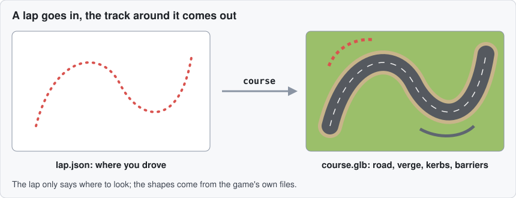
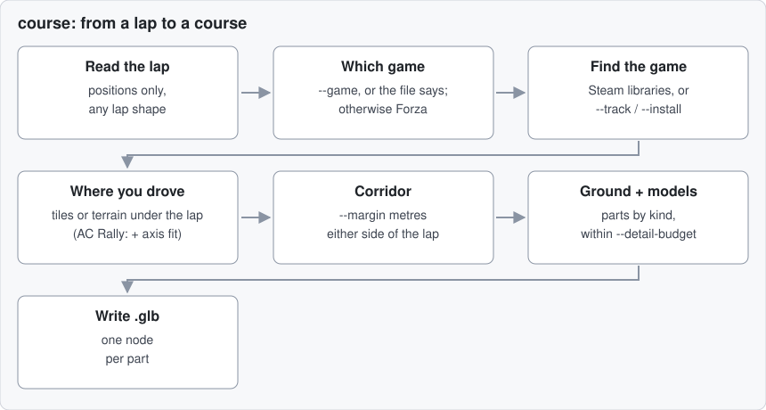

# Course export

**In plain words:** you drove a lap; this builds the track you drove on, as a
3D file. The lap is only a line of points; the road, grass and kerbs come from
the game's own files.



`course` turns a lap into a course: the ground in a band either side of where the
car went, and what stands on that ground, as one `.glb` for the viewer. This page
covers the steps; the page under it covers how each is done in the game's files:

- [How a Forza course is made](course-forza-horizon.md): finding the game, the track and the race; terrain, ground texture, placed models
- [Levels of detail and the budget](https://holdi601.github.io/3DHeat-GameFiles/detail-budget.html) (on the GameFiles site): how many triangles the placed models get, and which copies stay

```
heat3d-forza-maps course "Example Circuit"
heat3d-forza-maps course lap.json -o example.glb
```

The only thing it needs is the lap: where the game is installed, which track,
which race and where to cut are all worked out from it.



## The steps

Words used below: a **frame** is which way the axes point; the **corridor** is
the band of ground either side of the lap; a **tile** is one square piece of a
game's terrain; an **LOD** (level of detail) is one of a model's simpler copies.

1. **Read the lap.** Positions only, from any of the shapes in
   [Lap inputs](https://holdi601.github.io/3DHeat-GameFiles/lap-inputs.html). Speed and inputs are not used. A lap with fewer
   than two samples is refused ("holds no driving").
2. **Check the game.** `--game`, then the lap file's own `game`, then Forza. A
   BeamNG.drive or Assetto Corsa Rally lap is refused with the tool that exports
   it (see [Commands](commands.md#which-game)).
3. **Find the installed game.** Every Steam library listed in Steam's
   `config\libraryfolders.vdf` is searched, and `C:\XboxGames` for the Microsoft
   Store. `--track` skips the search.
4. **Find where the lap was driven.** This is never decided by a name match:
   the track whose terrain tiles cover the lap is the one.
5. **Find the race.** The lap is matched against the AI line of every race the
   game defines; the race it follows adds its own layer (barriers, tents,
   gantries) and takes away what it hides.
6. **Cut a corridor** `--margin` metres either side of the driving (below),
   widened to the whole of any venue the driving passes through.
7. **Build the ground** inside the corridor, classed as road, verge, terrain,
   markings, tyre marks or water, and bake a ground texture for each 512 m tile.
8. **Place the models** standing in the corridor, by category, at a level of
   detail chosen by distance and a triangle budget.
9. **Write the `.glb`**: one named node per part. See [Output format](https://holdi601.github.io/3DHeat-GameFiles/output-format.html).

What a run prints - here on a made-up track the tests build, a 30 m circle
around one guardrail and one kerb:


On a real track it also says `on <track>, in <game folder>` and which race it
found, and the counts run to hundreds of thousands of triangles.

## The corridor

The cut is a band around the driven line, not the lap's bounding box. For a
circuit the two are nearly the same. For a point-to-point sprint the box is mostly
hillside nobody drives past, and the band can be a tenth of its area. Source:
[`corridor.py`](https://github.com/Holdi601/3DHeat-GameFiles/blob/main/heat3d_gamefiles/corridor.py) in 3DHeat GameFiles.

How it is built:

- The driving is projected to the ground plane: x and z of the lap.
- It is rasterised on a grid of **4 m** cells (`CELL`). Each cell the driving
  touches is widened by a disc of radius `margin + 4 m` in every direction.
- Consecutive samples less than **50 m** apart (`JOIN`) are joined by points every
  4 m, so the band has no gaps. Samples further apart are treated as separate
  stretches of driving and are not joined. A library course is many lap files end
  to end, and the finish of one sprint and the start of the next must not draw a
  band across the map.
- A triangle is kept if any corner, the middle of any edge, or its centroid lies
  in the band. The middle points catch a large triangle that lies across a narrow
  band with all its corners outside.
- Height is never part of the cut. A box that bounded altitude would cut the
  ground out from under a hill the road climbs.

The console reports the corridor's area, for example
`cutting 80 m either side of the driving: 1.53 km2 of a 6,000 by 3,600 m box`.

Where the driving passes through a venue's own ground (a stadium's floor, a
festival site), the corridor takes in the whole of that ground, so the stands
and walls around it come too (see
[A venue is cut whole](course-forza-horizon.md#models-already-in-world-coordinates)).

## What the ground is made of

Every export classes its ground triangles into the same kinds, and each kind is
written as its own part so the viewer can show or hide it:

| Kind | Part name | Flat colour (linear RGB) | What it is |
|---|---|---|---|
| road | `ground:road` | 0.22, 0.22, 0.23 | road strips: the asphalt part |
| verge | `ground:verge` | 0.52, 0.47, 0.30 | road strips: the shoulder |
| terrain | `ground:terrain` | 0.30, 0.44, 0.18 | everything else |
| kerbs | `ground:kerbs` | 0.60, 0.12, 0.10 | `road_gen_rum*` props |
| venue | `ground:venue` | 0.33, 0.33, 0.34 | a venue's own ground: a stadium's floor, a festival site |
| plinths | `ground:plinths` | 0.42, 0.41, 0.39 | ground a street is dressed with: planters, steps, paving |
| markings | `ground:markings` | 0.90, 0.90, 0.88 | decal submeshes, lifted 5 cm |
| tyre marks | `ground:tyre marks` | 0.20, 0.17, 0.16 | decal submeshes, lifted 5 cm |
| water | `water:water` | 0.16, 0.34, 0.48 | water materials |

The flat colours are chosen to read at a glance, not to match the game. They are
used for parts without a texture and by viewers that ignore textures. Source:
[`surfaces.py`](https://github.com/Holdi601/3DHeat-GameFiles/blob/main/heat3d_gamefiles/surfaces.py).

Road, verge and terrain are split per 512 m terrain tile, and each tile carries
its own baked image, so the part names carry the tile's grid name (steps of
1023, see [How a Forza course is made](course-forza-horizon.md#terrain)), for
example `ground:road x-2046 z1023`.

## What stands on it

Placed models are written in parts named `structure:<category>`, or
`ground:kerbs` for kerbs. When a part has its own texture, the
texture or material name follows the category, for example
`structure:barriers bar_armco_bclr`.

| Category | Placed |
|---|---|
| barriers, props, signs, infrastructure, bridges, rocks | yes |
| buildings | yes (whole-building stand-ins where the game has them) |
| kerbs | yes, as ground |
| trees, bushes, smashables | with `--trees` |
| the race's own layer | `structure:event_<category>`, when the lap follows one of the game's races |
| other switched-on layers | `structure:layer_<category>` |

How detail is shared out: copies within 25 m of the
driving start at full detail, copies 25-60 m away one level coarser, and copies
further out at the coarsest level. Then the costliest models step down until a
triangle budget fits, and where even the coarsest levels do not fit a budget you
give, copies are left out. Kerbs are never simplified or left out. See
[Levels of detail and the budget](https://holdi601.github.io/3DHeat-GameFiles/detail-budget.html).

## Options that shape the result

| Want | Use |
|---|---|
| a smaller file | `--no-textures` (flat colours), `--texture-size 1024` or `512`, `--detail-budget N`, `--margin 40` |
| just the ground | `--no-placed` |
| the scenery too | `--trees` |
| a different season | `--season winter` |
| a game installed where it is not searched | `--track` |
| a lap the search does not place | `--track` |

## Coordinates

The course is written in the game's own world coordinates, unchanged: metres,
Y up, the frame the game's telemetry reports, so a recorded lap lies on it with
no placing or scaling. See [Output format](https://holdi601.github.io/3DHeat-GameFiles/output-format.html).
