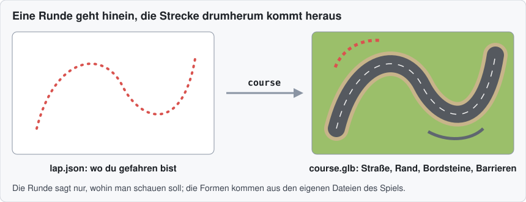
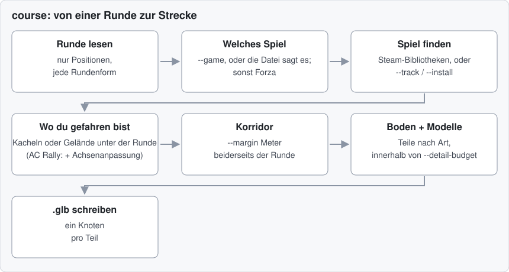

# Streckenexport {#course-export}

**Einfach gesagt:** Du bist eine Runde gefahren. Dieser Befehl baut die Strecke, die du gefahren bist, als 3D-Datei. Die Runde ist nur eine Reihe von Punkten. Die Straße, das Gras und die Randsteine kommen aus den eigenen Dateien des Spiels.



`course` macht aus einer Runde eine Strecke: den Boden in einem Streifen links und rechts von der Stelle, an der das Auto gefahren ist, und das, was auf diesem Boden steht, als eine `.glb`-Datei für den Viewer. Diese Seite beschreibt die Schritte. Die Seite darunter beschreibt, wie jeder Schritt in den Dateien des Spiels umgesetzt wird:

- [Wie eine Forza-Strecke entsteht](course-forza-horizon.md): das Spiel, die Strecke und das Rennen finden; Gelände, Bodentextur, platzierte Modelle
- [Detailstufen und Budget](https://holdi601.github.io/3DHeat-GameFiles/detail-budget.html) (auf der GameFiles-Seite): wie viele Dreiecke die platzierten Modelle bekommen und welche Kopien bleiben

```
heat3d-forza-maps course "Example Circuit"
heat3d-forza-maps course lap.json -o example.glb
```

Das Einzige, was es braucht, ist die Runde: Wo das Spiel installiert ist, welche Strecke, welches Rennen und wo geschnitten wird, wird alles aus ihr ermittelt.



## Die Schritte {#the-steps}

Begriffe, die unten vorkommen: ein **Frame** ist die Ausrichtung der Achsen; der **Korridor** ist der Streifen Boden links und rechts der Runde; eine **Kachel** ist ein quadratisches Stück des Geländes eines Spiels; eine **LOD** (Detailstufe) ist eine vereinfachte Kopie eines Modells.

1. **Die Runde lesen.** Nur Positionen, aus jeder der Formen in [Rundeneingaben](https://holdi601.github.io/3DHeat-GameFiles/lap-inputs.html). Geschwindigkeit und Eingaben werden nicht verwendet. Eine Runde mit weniger als zwei Punkten wird abgelehnt ("holds no driving").
2. **Das Spiel prüfen.** Zuerst `--game`, dann das Feld `game` der Rundendatei selbst, dann Forza. Eine Runde aus BeamNG.drive oder Assetto Corsa Rally wird mit dem Werkzeug abgelehnt, das sie exportiert (siehe [Befehle](commands.md#which-game)).
3. **Das installierte Spiel finden.** Jede Steam-Bibliothek, die in Steams `config\libraryfolders.vdf` steht, wird durchsucht, dazu `C:\XboxGames` für den Microsoft Store. `--track` überspringt die Suche.
4. **Finden, wo die Runde gefahren wurde.** Das wird nie über einen Namensvergleich entschieden. Es ist die Strecke, deren Geländekacheln die Runde abdecken.
5. **Das Rennen finden.** Die Runde wird mit der KI-Linie jedes Rennens verglichen, das das Spiel festlegt. Das Rennen, dem sie folgt, fügt seine eigene Schicht hinzu (Barrieren, Zelte, Portale) und nimmt weg, was es versteckt.
6. **Einen Korridor ausschneiden**, `--margin` Meter auf jeder Seite der Fahrt (unten), auf die ganze Fläche eines Veranstaltungsorts erweitert, durch den die Fahrt führt.
7. **Den Boden bauen** innerhalb des Korridors, eingeteilt in Fahrbahn, Randstreifen, Gelände, Markierungen, Reifenspuren oder Wasser, und für jede 512-m-Kachel eine Bodentextur backen.
8. **Die Modelle platzieren**, die im Korridor stehen, nach Kategorie, mit einer Detailstufe, die nach Entfernung und einem Dreiecksbudget gewählt wird.
9. **Die `.glb` schreiben**: ein benannter Knoten je Teil. Siehe [Ausgabeformat](https://holdi601.github.io/3DHeat-GameFiles/output-format.html).

Was ein Lauf ausgibt, hier auf einer erfundenen Strecke, die die Tests bauen: ein Kreis von 30 m um eine Leitplanke und einen Bordstein:


Auf einer echten Strecke steht außerdem `on <track>, in <game folder>` da, und welches Rennen gefunden wurde. Die Zahlen gehen in die Hunderttausende Dreiecke.

## Der Korridor {#the-corridor}

Der Ausschnitt ist ein Band um die gefahrene Linie, nicht die Begrenzungsbox der Runde. Bei einer Rundstrecke sind beide fast gleich. Bei einem Sprint von A nach B besteht die Box größtenteils aus Hängen, an denen niemand vorbeifährt, und das Band kann nur ein Zehntel ihrer Fläche haben. Quelle: [`corridor.py`](https://github.com/Holdi601/3DHeat-GameFiles/blob/main/heat3d_gamefiles/corridor.py) in 3DHeat GameFiles.

So wird er gebaut:

- Die Fahrt wird auf die Bodenebene projiziert: x und z der Runde.
- Sie wird auf ein Raster aus Zellen zu **4 m** gerastert (`CELL`). Jede Zelle, die die Fahrt berührt, wird in alle Richtungen um eine Scheibe mit dem Radius `margin + 4 m` verbreitert.
- Aufeinanderfolgende Punkte, die weniger als **50 m** auseinanderliegen (`JOIN`), werden durch Punkte alle 4 m verbunden, damit das Band keine Lücken hat. Weiter auseinanderliegende Punkte gelten als getrennte Stücke der Fahrt und werden nicht verbunden. Eine Bibliotheksstrecke besteht aus vielen Rundendateien hintereinander. Das Ziel des einen Sprints und der Start des nächsten dürfen kein Band quer über die Karte ziehen.
- Ein Dreieck bleibt erhalten, wenn eine Ecke, die Mitte einer Kante oder sein Schwerpunkt im Band liegt. Die Mittelpunkte fangen ein großes Dreieck ein, das quer über einem schmalen Band liegt, während alle seine Ecken außerhalb liegen.
- Die Höhe spielt beim Ausschnitt nie eine Rolle. Eine Box, die die Höhe begrenzt, würde den Boden unter einem Hügel abschneiden, den die Straße hinaufführt.

Die Konsole meldet die Fläche des Korridors, zum Beispiel `cutting 80 m either side of the driving: 1.53 km2 of a 6,000 by 3,600 m box`.

Führt die Fahrt über den eigenen Boden eines Veranstaltungsorts (der Boden eines Stadions, ein Festivalgelände), nimmt der Korridor den ganzen Boden auf. So kommen die Tribünen und Mauern drumherum auch mit (siehe [Ein Veranstaltungsort wird ganz ausgeschnitten](course-forza-horizon.md#models-already-in-world-coordinates)).

## Woraus der Boden besteht {#what-the-ground-is-made-of}

Jeder Export ordnet seine Bodendreiecke in dieselben Arten ein. Jede Art wird als eigener Teil geschrieben, damit der Viewer sie ein- und ausblenden kann:

| Art | Teilname | Einfarbige Fläche (lineares RGB) | Was es ist |
|---|---|---|---|
| Fahrbahn | `ground:road` | 0,22, 0,22, 0,23 | Straßenstreifen: der Asphaltteil |
| Randstreifen | `ground:verge` | 0,52, 0,47, 0,30 | Straßenstreifen: der Seitenstreifen |
| Gelände | `ground:terrain` | 0,30, 0,44, 0,18 | alles Übrige |
| Randsteine | `ground:kerbs` | 0,60, 0,12, 0,10 | `road_gen_rum*`-Requisiten |
| Veranstaltungsort | `ground:venue` | 0,33, 0,33, 0,34 | der eigene Boden eines Veranstaltungsorts: ein Stadionboden, ein Festivalgelände |
| Sockel | `ground:plinths` | 0,42, 0,41, 0,39 | Boden, mit dem eine Straße gestaltet wird: Pflanzkübel, Stufen, Pflaster |
| Markierungen | `ground:markings` | 0,90, 0,90, 0,88 | Decal-Teilmeshes, 5 cm angehoben |
| Reifenspuren | `ground:tyre marks` | 0,20, 0,17, 0,16 | Decal-Teilmeshes, 5 cm angehoben |
| Wasser | `water:water` | 0,16, 0,34, 0,48 | Wassermaterialien |

Die einfarbigen Flächen sind so gewählt, dass man sie auf einen Blick erkennt, nicht so, dass sie zum Spiel passen. Sie werden für Teile ohne Textur verwendet und von Viewern, die Texturen ignorieren. Quelle: [`surfaces.py`](https://github.com/Holdi601/3DHeat-GameFiles/blob/main/heat3d_gamefiles/surfaces.py).

Fahrbahn, Randstreifen und Gelände werden je 512-m-Geländekachel aufgeteilt, und jede Kachel trägt ihr eigenes eingebackenes Bild. Deshalb trägt der Teilname den Rasternamen der Kachel (Schritte von 1023, siehe [Wie eine Forza-Strecke entsteht](course-forza-horizon.md#terrain)), zum Beispiel `ground:road x-2046 z1023`.

## Was auf dem Boden steht {#what-stands-on-it}

Platzierte Modelle werden in Teile namens `structure:<category>` geschrieben, oder als `ground:kerbs` für Randsteine. Hat ein Teil eine eigene Textur, folgt dem Kategorienamen der Name der Textur oder des Materials, zum Beispiel `structure:barriers bar_armco_bclr`.

| Kategorie | Platziert |
|---|---|
| Barrieren, Requisiten, Schilder, Infrastruktur, Brücken, Felsen | ja |
| Gebäude | ja (ganze Gebäude als Ersatz, wo das Spiel sie hat) |
| Randsteine | ja, als Boden |
| Bäume, Büsche, zerstörbare Objekte | mit `--trees` |
| die eigene Schicht des Rennens | `structure:event_<category>`, wenn die Runde einem der Rennen des Spiels folgt |
| andere eingeschaltete Schichten | `structure:layer_<category>` |

So wird die Detailstufe verteilt: Kopien innerhalb von 25 m zur Fahrt beginnen mit voller Detailstufe, Kopien 25 bis 60 m entfernt eine Stufe gröber, und weiter entfernte Kopien in der gröbsten Stufe. Danach werden die teuersten Modelle herabgestuft, bis ein Dreiecksbudget passt. Reichen selbst die gröbsten Stufen nicht für ein Budget, das du vorgibst, werden Kopien weggelassen. Randsteine werden nie vereinfacht oder weggelassen. Siehe [Detailstufen und Budget](https://holdi601.github.io/3DHeat-GameFiles/detail-budget.html).

## Optionen, die das Ergebnis formen {#options-that-shape-the-result}

| Wunsch | Option |
|---|---|
| eine kleinere Datei | `--no-textures` (einfarbige Flächen), `--texture-size 1024` oder `512`, `--detail-budget N`, `--margin 40` |
| nur den Boden | `--no-placed` |
| auch die Szenerie | `--trees` |
| eine andere Jahreszeit | `--season winter` |
| ein Spiel an einem Ort, der nicht durchsucht wird | `--track` |
| eine Runde, die die Suche nicht zuordnet | `--track` |

## Koordinaten {#coordinates}

Die Strecke wird in den eigenen Weltkoordinaten des Spiels geschrieben, unverändert: Meter, Y nach oben, das Bezugssystem, das die Telemetrie des Spiels meldet. Deshalb liegt eine aufgezeichnete Runde ohne Platzierung oder Skalierung darauf. Siehe [Ausgabeformat](https://holdi601.github.io/3DHeat-GameFiles/output-format.html).
