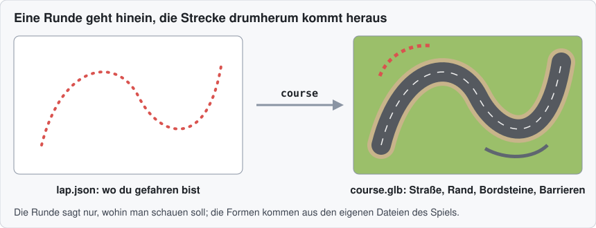

# 3DHeat Forza {#dheat-forza}

**Was ist das?** Ein Werkzeug, das aus dem Forza, das du bereits installiert hast, ein 3D-Modell einer Forza-Rennstrecke baut. Du gibst ihm eine Runde, die du gefahren bist, und es schreibt die Straße, den Randstreifen und das Gras, die Bordsteine, Leitplanken, Reifenwände, Schilder und Gebäude rundherum als eine einzige 3D-Datei.

**Wozu brauche ich es?** Der [3DHeat](https://github.com/Holdi601/3DHeat)-Viewer ([Doku](https://holdi601.github.io/3DHeat/)) malt, wo du gefahren bist, als Hitze, und sein Tab Rennanalyse vergleicht Runden Kurve für Kurve. Mit diesem Werkzeug malt er sie auf die echte Strecke statt auf leeren Raum, und zeichnet jedes aufgenommene Auto in seiner eigenen Form.

**Beispiel:** `heat3d-forza-maps course "Example Circuit"` findet das Spiel, die Strecke und das Rennen, auf dem die Runden gefahren wurden, und schreibt `example_circuit.glb`:



Es liest Forza Horizon und Forza Motorsport, die Spiele auf ForzaTech, der Engine von Turn 10, aus Steam oder dem Microsoft Store. Python-Paket: `heat3d_ext_forza`. Repository: [Holdi601/3DHeat-Ext-Forza](https://github.com/Holdi601/3DHeat-Ext-Forza). Lizenz: MIT.

Jeder Spiele-Leser ist ein eigenes kleines Projekt mit eigener Lizenzdatei, eigenen Releases und eigenem Issue-Tracker. So lässt er sich für sich allein installieren, aktualisieren und pflegen - oder auf Wunsch eines Rechteinhabers zurückziehen -, ohne dass der Viewer oder die anderen Werkzeuge davon berührt werden.

Was es schreibt, bleibt auf deinem Rechner ([Regeln und Lizenzen](terms.md)).

## Schnellstart {#quick-start}

Du brauchst Windows, Python 3.10 oder neuer (im Installer "Add python.exe to PATH"
ankreuzen), ein Forza Horizon oder Forza Motorsport, über Steam oder den Microsoft
Store installiert (wird von selbst gefunden), und eine Runde, die du gefahren bist;
Git ist nicht nötig. Du kennst die Kommandozeile noch nicht? Lies zuerst
[Bevor du anfängst](before-you-start.md).

```bash
python -m pip install https://github.com/Holdi601/3DHeat-Ext-Forza/archive/refs/tags/v1.0.0.zip
heat3d-forza-maps course laps\<lap>.lap.json -o my_course.glb    # die Strecke um eine aufgenommene Runde
heat3d-forza-maps course "<course name>"                         # oder eine Strecke der FH-Companion-Bibliothek, nach Namen
heat3d-forza-maps cars                                           # jedes Auto, für den Tab Rennanalyse
```

Die Installation bringt [3DHeat GameFiles](https://holdi601.github.io/3DHeat-GameFiles/)
mit, die Bibliothek, mit der es liest. Eine Runde kommt von
[3DHeat GameCapture](https://github.com/Holdi601/3DHeat-GameCapture) (im Spiel Data Out
auf `127.0.0.1`, Port `5300` einschalten, dann
`python -m heat3d_capture telemetry -o laps`) oder aus der FH-Companion-Rundenbibliothek
(`%LOCALAPPDATA%\FHCompanion\laps`, wird von selbst gefunden). `course` sagt, welche
Strecke und welches Rennen es gefunden hat, und endet mit
`wrote my_course.glb (... bytes)`; ohne `-o` heißt die Datei nach der Strecke
(`"Example Circuit"` -> `example_circuit.glb`). `cars` schreibt `forza.h3dcars`
(etwa 5 MB, in Sekunden). Beide landen in dem Ordner, in dem du den Befehl ausgeführt
hast.

Dann öffne sie im [3DHeat-Viewer](https://github.com/Holdi601/3DHeat#quick-start):
herunterladen (**Code -> Download ZIP**, entpacken), `start.bat` doppelklicken (es bietet
an, Node.js zu installieren, wenn es fehlt, und öffnet `http://127.0.0.1:5273`), dann
**Hintergrund / Level -> 3D-Modell...** und die `.glb` wählen; im Tab **Rennanalyse**
mit **Rundendateien laden...** deine Runden wählen und mit **Autodatei laden...** (in den
Ansichtseinstellungen des Tabs) `forza.h3dcars`.

Wenn ein neues Release erscheint, sagt das Werkzeug es beim Start und bietet an, sich
selbst zu aktualisieren.

## Was es tut {#what-it-does}

| Befehl | Tut | Seite |
|---|---|---|
| `course <lap>` | die Strecke um eine Runde: Boden, bei dem Fahrbahn und Randstreifen getrennt sind, eine Bodentextur, jedes platzierte Modell in seiner eigenen Textur, die eigene Schicht des Rennens | [Streckenexport](course-export.md), [Wie eine Forza-Strecke entsteht](course-forza-horizon.md) |
| `courses` | `course` für jede Strecke in einer aufgezeichneten Rundenbibliothek | [Befehle](commands.md#courses) |
| `races` | jedes Rennen, das das Spiel festlegt, und ob deine Exporte davon aktuell sind | [Befehle](commands.md#races) |
| `terrain <track>` | ein Stück Strecke nach Weltkoordinaten, ohne Runde | [Befehle](commands.md#terrain) |
| `cars` | jedes Auto in niedriger Detailstufe, in einer Datei für den Viewer | [Forza-Autos](forza-cars.md) |
| `identify`, `list`, `extract` | was eine Forza-Datei ist, was eine `.minizip` enthält, ein Eintrag herausgeholt | [Forza-Dateien untersuchen](inspecting-files.md) |

So werden die Dateien des Spiels gelesen, Byte für Byte: [ForzaTech](reader-forzatech.md). Jede Option: [Befehlsreferenz](../cli-reference.md).

Es baut auf [3DHeat GameFiles](https://holdi601.github.io/3DHeat-GameFiles/) auf. Das liefert den glTF-Schreiber, die Rundenleser, den Korridor und das Detailbudget. Außerdem startet GameFiles dieses Werkzeug für seine eigenen Befehle `course`, `courses`, `races`, `cars` und `terrain` bei einer Forza-Runde. Seiten dort, die auch hier gelten:
[Rundeneingaben](https://holdi601.github.io/3DHeat-GameFiles/lap-inputs.html),
[Detailstufen und Budget](https://holdi601.github.io/3DHeat-GameFiles/detail-budget.html),
[Ausgabeformat](https://holdi601.github.io/3DHeat-GameFiles/output-format.html),
[Grenzen und bekannte Lücken](https://holdi601.github.io/3DHeat-GameFiles/limits-and-known-gaps.html).

## Seiten {#pages}

| Seite | Was sie behandelt |
|---|---|
| [Bevor du anfängst](before-you-start.md) | Python, ein Terminal, Installieren, ein erster Lauf |
| [Befehle](commands.md) | jeder Befehl, seine Optionen, Exit-Codes |
| [Streckenexport](course-export.md) | `course` Schritt für Schritt: der Korridor, der Boden, was darauf steht |
| [Wie eine Forza-Strecke entsteht](course-forza-horizon.md) | das Spiel, die Strecke und das Rennen finden; Gelände, Texturen, platzierte Modelle |
| [Forza-Autos](forza-cars.md) | `cars` und die Autodatei |
| [Forza-Dateien untersuchen](inspecting-files.md) | `identify`, `list`, `extract` |
| [ForzaTech](reader-forzatech.md) | die Dateiformate |
| [Regeln und Lizenzen](terms.md) | die Spieldateien, was du mit der Ausgabe tun darfst |
| [Befehlsreferenz](../cli-reference.md) | jede Option, aus dem Code erzeugt |
| [Diese Doku pflegen](maintaining.md) | Tests und die Checkliste für Veröffentlichungen |

## Die 3DHeat-Werkzeuge {#the-3dheat-tools}

| Werkzeug | Was es tut | Code | Doku |
|---|---|---|---|
| 3DHeat-Viewer | zeigt die Daten: Heatmaps, Rennanalyse, Matchauswertung | [3DHeat](https://github.com/Holdi601/3DHeat) | [Doku](https://holdi601.github.io/3DHeat/) |
| GameFiles | Level und Strecken aus den eigenen Dateien eines Spiels | [3DHeat-GameFiles](https://github.com/Holdi601/3DHeat-GameFiles) | [Doku](https://holdi601.github.io/3DHeat-GameFiles/) |
| GameCapture | Rundentelemetrie und Level, die aus Gameplay-Video nachgebaut werden | [3DHeat-GameCapture](https://github.com/Holdi601/3DHeat-GameCapture) | [Doku](https://holdi601.github.io/3DHeat-GameCapture/) |
| Unreal Exporter | ein Plugin für den Unreal Editor: ein Level als eine `.glb` | [3DHeat-UnrealExporter](https://github.com/Holdi601/3DHeat-UnrealExporter) | [Doku](https://holdi601.github.io/3DHeat-UnrealExporter/) |
| CS2 | Counter-Strike-2-Demos und -Karten | [3DHeat-CS2](https://github.com/Holdi601/3DHeat-CS2) | [Doku](https://holdi601.github.io/3DHeat-CS2/) |
| Watcher | zeichnet auf, was Spiele veröffentlichen, während du spielst | [3DHeat-Watcher](https://github.com/Holdi601/3DHeat-Watcher) | [Doku](https://holdi601.github.io/3DHeat-Watcher/) |
| Ext-WarThunder | War-Thunder-Wiederholungen | [3DHeat-Ext-WarThunder](https://github.com/Holdi601/3DHeat-Ext-WarThunder) | [Doku](https://holdi601.github.io/3DHeat-Ext-WarThunder/) |
| Ext-WoT | World-of-Tanks-Wiederholungen | [3DHeat-Ext-WoT](https://github.com/Holdi601/3DHeat-Ext-WoT) | [Doku](https://holdi601.github.io/3DHeat-Ext-WoT/) |
| Ext-WoWs | World-of-Warships-Wiederholungen | [3DHeat-Ext-WoWs](https://github.com/Holdi601/3DHeat-Ext-WoWs) | [Doku](https://holdi601.github.io/3DHeat-Ext-WoWs/) |
| Ext-Squad | Squad-Server-Demos | [3DHeat-Ext-Squad](https://github.com/Holdi601/3DHeat-Ext-Squad) | [Doku](https://holdi601.github.io/3DHeat-Ext-Squad/) |
| Ext-DCS | DCS-World-Karten als 3D-Level | [3DHeat-Ext-DCS](https://github.com/Holdi601/3DHeat-Ext-DCS) | [Doku](https://holdi601.github.io/3DHeat-Ext-DCS/) |
| Ext-IL2 | IL-2-Sturmovik-Karten als 3D-Level | [3DHeat-Ext-IL2](https://github.com/Holdi601/3DHeat-Ext-IL2) | [Doku](https://holdi601.github.io/3DHeat-Ext-IL2/) |
| Ext-Dota | die Dota-2-Karte als 3D-Level | [3DHeat-Ext-Dota](https://github.com/Holdi601/3DHeat-Ext-Dota) | [Doku](https://holdi601.github.io/3DHeat-Ext-Dota/) |
| Ext-DotaReplay | Dota-2-Wiederholungen | [3DHeat-Ext-DotaReplay](https://github.com/Holdi601/3DHeat-Ext-DotaReplay) | [Doku](https://holdi601.github.io/3DHeat-Ext-DotaReplay/) |
| Ext-Riot | League-of-Legends- und Valorant-Wiederholungen | [3DHeat-Ext-Riot](https://github.com/Holdi601/3DHeat-Ext-Riot) | [Doku](https://holdi601.github.io/3DHeat-Ext-Riot/) |
| **Ext-Forza** | **Forza-Strecken, -Rennen und -Autos aus deiner eigenen Installation** | [3DHeat-Ext-Forza](https://github.com/Holdi601/3DHeat-Ext-Forza) | [Doku](https://holdi601.github.io/3DHeat-Ext-Forza/) |
| Ext-Battlefield | Battlefield-6-Level aus deiner eigenen Installation | [3DHeat-Ext-Battlefield](https://github.com/Holdi601/3DHeat-Ext-Battlefield) | [Doku](https://holdi601.github.io/3DHeat-Ext-Battlefield/) |
| Ext-BeamNG | BeamNG.drive-Strecken aus deiner eigenen Installation | [3DHeat-Ext-BeamNG](https://github.com/Holdi601/3DHeat-Ext-BeamNG) | [Doku](https://holdi601.github.io/3DHeat-Ext-BeamNG/) |
| Ext-ACRally | Assetto-Corsa-Rally-Etappen aus deiner eigenen Installation | [3DHeat-Ext-ACRally](https://github.com/Holdi601/3DHeat-Ext-ACRally) | [Doku](https://holdi601.github.io/3DHeat-Ext-ACRally/) |
| Ext-Reforger | Arma-Reforger-Welten aus deiner eigenen Installation | [3DHeat-Ext-Reforger](https://github.com/Holdi601/3DHeat-Ext-Reforger) | [Doku](https://holdi601.github.io/3DHeat-Ext-Reforger/) |
| Ext-R6 | Rainbow-Six-Siege-Match-Wiederholungen | [3DHeat-Ext-R6](https://github.com/Holdi601/3DHeat-Ext-R6) | [Doku](https://holdi601.github.io/3DHeat-Ext-R6/) |
