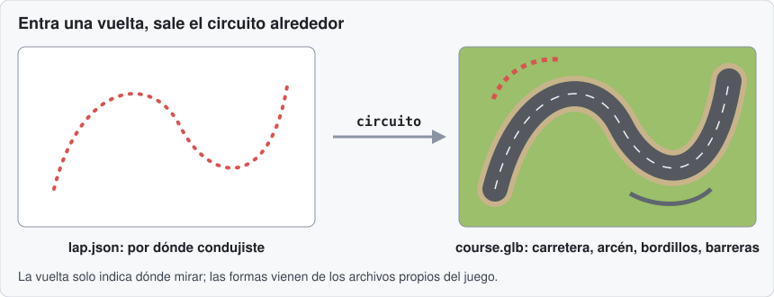
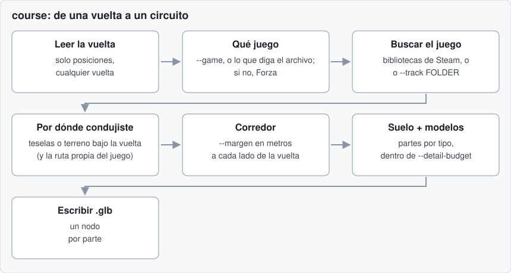

# Exportación de circuito {#course-export}

**En pocas palabras:** has dado una vuelta; esto construye el circuito por el que condujiste, como
un archivo 3D. La vuelta es solo una línea de puntos; la carretera, la hierba y los bordillos
vienen de los propios archivos del juego.



`course` convierte una vuelta en un circuito: el suelo en una franja a cada lado de por dónde fue el
coche, y lo que está sobre ese suelo, todo en un único `.glb` para el visor. Esta página cubre los
pasos; la página que cuelga de ella cubre cómo se hace cada uno en los archivos del juego:

- [Cómo se hace un circuito de Forza](course-forza-horizon.md): encontrar el juego, el circuito y la carrera; terreno, textura del suelo, modelos colocados
- [Niveles de detalle y presupuesto](https://holdi601.github.io/3DHeat-GameFiles/detail-budget.html) (en el sitio de GameFiles): cuántos triángulos reciben los modelos colocados, y qué copias se quedan

```
heat3d-forza-maps course "Example Circuit"
heat3d-forza-maps course lap.json -o example.glb
```

Lo único que necesita es la vuelta: dónde está instalado el juego, qué circuito, qué carrera y
dónde cortar, todo se calcula a partir de ella.



## Los pasos {#the-steps}

Palabras que se usan abajo: un **marco** es hacia dónde apuntan los ejes; el **corredor** es la
franja de suelo a cada lado de la vuelta; una **loseta** es una pieza cuadrada del terreno de un
juego; un **LOD** (nivel de detalle) es una de las copias más simples de un modelo.

1. **Leer la vuelta.** Solo posiciones, de cualquiera de las formas de
   [Entradas de vuelta](https://holdi601.github.io/3DHeat-GameFiles/lap-inputs.html). La velocidad y
   los controles no se usan. Una vuelta con menos de dos muestras se rechaza ("holds no driving").
2. **Comprobar el juego.** `--game`, luego el campo `game` del archivo de la vuelta, luego Forza. Una
   vuelta de BeamNG.drive o de Assetto Corsa Rally se rechaza con la herramienta que la exporta (ver
   [Comandos](commands.md#which-game)).
3. **Encontrar el juego instalado.** Se busca en cada biblioteca de Steam que aparece en
   `config\libraryfolders.vdf` de Steam, y en `C:\XboxGames` para la Microsoft Store. `--track` salta
   la búsqueda.
4. **Encontrar dónde se condujo la vuelta.** Esto nunca se decide por coincidencia de nombre: el
   circuito cuyas losetas de terreno cubren la vuelta es el correcto.
5. **Encontrar la carrera.** La vuelta se compara con la línea de IA de cada carrera que define el
   juego; la carrera que sigue añade su propia capa (barreras, carpas, pórticos) y quita lo que oculta.
6. **Cortar un corredor** de `--margin` metros a cada lado de la conducción (abajo), ampliado a todo
   recinto por el que pase la conducción.
7. **Construir el suelo** dentro del corredor, clasificado como carretera, arcén, terreno, marcas,
   huellas de neumáticos o agua, y hornear una textura de suelo para cada cuadrado de 512 m.
8. **Colocar los modelos** que están en el corredor, por categoría, con un nivel de detalle elegido
   por distancia y un presupuesto de triángulos.
9. **Escribir el `.glb`**: un nodo con nombre por parte. Ver
   [Formato de salida](https://holdi601.github.io/3DHeat-GameFiles/output-format.html).

Lo que imprime una ejecución, en un circuito inventado que construyen las pruebas (un círculo de
30 m alrededor de una barrera y un bordillo):


En un circuito real también dice `on <track>, in <game folder>` y qué carrera encontró, y las
cifras llegan a cientos de miles de triángulos.

## El corredor {#the-corridor}

El corte es una banda alrededor de la línea conducida, no la caja que envuelve la vuelta. En un
circuito cerrado las dos son casi iguales. En un sprint de punto a punto, la caja es sobre todo
ladera que nadie recorre, y la banda puede ser una décima parte de su área. Fuente:
[`corridor.py`](https://github.com/Holdi601/3DHeat-GameFiles/blob/main/heat3d_gamefiles/corridor.py)
en 3DHeat GameFiles.

Cómo se construye:

- La conducción se proyecta al plano del suelo: x y z de la vuelta.
- Se rasteriza en una rejilla de celdas de **4 m** (`CELL`). Cada celda que toca la conducción se ensancha con un disco de radio `margin + 4 m` en todas las direcciones.
- Las muestras consecutivas a menos de **50 m** (`JOIN`) se unen con puntos cada 4 m, para que la banda no tenga huecos. Las muestras más separadas se tratan como tramos de conducción distintos y no se unen. Una biblioteca de circuitos son muchos archivos de vuelta seguidos, y la llegada de un sprint y la salida del siguiente no deben trazar una banda a través del mapa.
- Un triángulo se conserva si cualquier esquina, el punto medio de cualquier arista o su centroide cae en la banda. Los puntos medios atrapan un triángulo grande que cruza una banda estrecha con todas sus esquinas fuera.
- La altura nunca forma parte del corte. Una caja que acotara la altitud cortaría el suelo debajo de una colina que sube la carretera.

La consola informa del área del corredor, por ejemplo `cutting 80 m either side of the driving: 1.53 km2 of a 6,000 by 3,600 m box`.

Donde la conducción pasa por el suelo propio de un recinto (el suelo de un estadio, un recinto de
festival), el corredor incluye todo ese suelo, así que también llegan las gradas y los muros
alrededor (mira [Un recinto se corta entero](course-forza-horizon.md#models-already-in-world-coordinates)).

## De qué está hecho el suelo {#what-the-ground-is-made-of}

Cada exportación clasifica sus triángulos de suelo en los mismos tipos, y cada tipo se escribe como
su propia parte para que el visor pueda mostrarla u ocultarla:

| Tipo | Nombre de la parte | Color plano (RGB lineal) | Qué es |
|---|---|---|---|
| carretera | `ground:road` | 0.22, 0.22, 0.23 | tiras de carretera: la parte de asfalto |
| arcén | `ground:verge` | 0.52, 0.47, 0.30 | tiras de carretera: el arcén |
| terreno | `ground:terrain` | 0.30, 0.44, 0.18 | todo lo demás |
| bordillos | `ground:kerbs` | 0.60, 0.12, 0.10 | objetos `road_gen_rum*` |
| recinto | `ground:venue` | 0.33, 0.33, 0.34 | el suelo propio de un recinto: el suelo de un estadio, un recinto de festival |
| bases | `ground:plinths` | 0.42, 0.41, 0.39 | suelo con el que se decora una calle: jardineras, escalones, adoquines |
| marcas | `ground:markings` | 0.90, 0.90, 0.88 | submallas de calcomanía, elevadas 5 cm |
| huellas de neumáticos | `ground:tyre marks` | 0.20, 0.17, 0.16 | submallas de calcomanía, elevadas 5 cm |
| agua | `water:water` | 0.16, 0.34, 0.48 | materiales de agua |

Los colores planos se eligen para leerse de un vistazo, no para parecerse al juego. Se usan en las
partes sin textura y en los visores que ignoran las texturas. Fuente:
[`surfaces.py`](https://github.com/Holdi601/3DHeat-GameFiles/blob/main/heat3d_gamefiles/surfaces.py).

Carretera, arcén y terreno se separan por loseta de 512 m, y cada loseta lleva su propia imagen
horneada, así que los nombres de las partes llevan el nombre de rejilla de la loseta (pasos de
1023, ver [Cómo se hace un circuito de Forza](course-forza-horizon.md#terrain)), por ejemplo
`ground:road x-2046 z1023`.

## Lo que está sobre el suelo {#what-stands-on-it}

Los modelos colocados se escriben en partes llamadas `structure:<category>`, o `ground:kerbs` para
los bordillos. Cuando una parte tiene su propia textura, la textura o el nombre del material sigue a
la categoría, por ejemplo `structure:barriers bar_armco_bclr`.

| Categoría | Colocado |
|---|---|
| barreras, props, señales, infraestructura, puentes, rocas | sí |
| edificios | sí (sustitutos de edificio entero donde el juego los tiene) |
| bordillos | sí, como suelo |
| árboles, arbustos, objetos rompibles | con `--trees` |
| la capa propia de la carrera | `structure:event_<category>`, cuando la vuelta sigue una de las carreras del juego |
| otras capas activadas | `structure:layer_<category>` |

Las copias a 25 m o menos de la conducción empiezan con el detalle completo, las copias a 25-60 m
un nivel más grosero, y las que están más lejos, en el nivel más grosero. Luego los modelos más
costosos bajan de nivel hasta que encaja un presupuesto de triángulos, y donde ni los niveles más
gruesos encajan en un presupuesto que tú das, se dejan fuera copias. Los bordillos nunca se
simplifican ni se dejan fuera. Ver [Niveles de detalle y presupuesto](https://holdi601.github.io/3DHeat-GameFiles/detail-budget.html).

## Opciones que cambian el resultado {#options-that-shape-the-result}

| Quieres | Usa |
|---|---|
| un archivo más pequeño | `--no-textures` (colores planos), `--texture-size 1024` o `512`, `--detail-budget N`, `--margin 40` |
| solo el suelo | `--no-placed` |
| también el paisaje | `--trees` |
| otra temporada | `--season winter` |
| un juego instalado donde no se busca | `--track` |
| una vuelta que la búsqueda no ubica | `--track` |

## Coordenadas {#coordinates}

El circuito se escribe en las propias coordenadas del mundo del juego, sin cambios: metros, Y hacia
arriba, en el marco que reporta la telemetría del juego, así que una vuelta grabada cae sobre él
sin colocarla ni escalarla. Ver [Formato de salida](https://holdi601.github.io/3DHeat-GameFiles/output-format.html).
