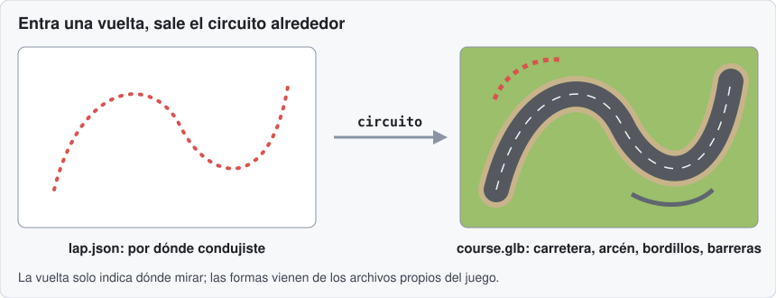

# 3DHeat Forza {#dheat-forza}

**¿Qué es?** Una herramienta que construye un modelo 3D de un circuito de carreras de Forza a
partir del Forza que ya tienes instalado: le das una vuelta que condujiste, y escribe como un
único archivo 3D la carretera, el arcén, la hierba, los bordillos, las barreras, los muros de
neumáticos, las señales y los edificios que la rodean.

**¿Para qué sirve?** El visor [3DHeat](https://github.com/Holdi601/3DHeat)
([documentación](https://holdi601.github.io/3DHeat/)) pinta de calor dónde condujiste, y su
pestaña Análisis de carrera compara vueltas curva a curva. Con esta herramienta las pinta sobre
el circuito real, no sobre un espacio vacío, y dibuja cada coche registrado con su propia forma.

**Ejemplo:** `heat3d-forza-maps course "Example Circuit"` encuentra el juego, el circuito y la
carrera en la que se condujeron las vueltas, y escribe `example_circuit.glb`:



Lee Forza Horizon y Forza Motorsport, los juegos del motor ForzaTech de Turn 10, desde Steam o
la Microsoft Store. Paquete de Python: `heat3d_ext_forza`. Repositorio:
[Holdi601/3DHeat-Ext-Forza](https://github.com/Holdi601/3DHeat-Ext-Forza). Licencia: MIT.

Esta herramienta está separada de las demás herramientas de 3DHeat a propósito: lee los
archivos del juego de Microsoft. Si alguna vez hubiera que retirarla, no se iría nada más con
ella. Lo que escribe se queda en tu equipo ([Términos y licencia](terms.md)).

## Inicio rápido {#quick-start}

¿Nuevo en la línea de comandos? Lee primero [Antes de empezar](before-you-start.md). Necesitas
Python 3.10 o posterior y un Forza instalado por Steam o por la Microsoft Store.

```
git clone https://github.com/Holdi601/3DHeat-Ext-Forza.git
cd 3DHeat-Ext-Forza
python -m pip install -e .                      # the heat3d-forza-maps command, and 3DHeat GameFiles
heat3d-forza-maps course "Example Circuit"      # a course from the FH Companion lap library, by name
heat3d-forza-maps cars                          # every car, for the Race analysis tab
```

`course` termina con `wrote example_circuit.glb (... bytes)`. Carga el archivo en el panel
**Fondo / nivel** del visor con **Modelo 3D…**; carga el archivo de coches con
**Cargar archivo de coches…** en los ajustes de vista de la pestaña Análisis de carrera.

## Qué hace {#what-it-does}

| Comando | Hace | Página |
|---|---|---|
| `course <lap>` | el circuito alrededor de una vuelta: suelo con carretera y arcén separados, una textura de suelo, cada modelo colocado con su propia textura, la capa propia de la carrera | [Exportación de circuito](course-export.md), [Cómo se hace un circuito de Forza](course-forza-horizon.md) |
| `courses` | `course` para cada circuito de una biblioteca de vueltas grabadas | [Comandos](commands.md#courses) |
| `races` | cada carrera que define el juego, y si tus exportaciones de ella están al día | [Comandos](commands.md#races) |
| `terrain <track>` | un trozo de circuito por coordenadas del mundo, sin necesidad de vuelta | [Comandos](commands.md#terrain) |
| `cars` | cada coche con poco detalle, en un solo archivo para el visor | [Coches de Forza](forza-cars.md) |
| `identify`, `list`, `extract` | qué es un archivo de Forza, qué contiene un `.minizip`, sacar una entrada | [Inspeccionar archivos de Forza](inspecting-files.md) |

Cómo se leen los archivos del juego, byte a byte: [ForzaTech](reader-forzatech.md). Cada opción:
[Referencia de comandos](../cli-reference.md).

Está construida sobre [3DHeat GameFiles](https://holdi601.github.io/3DHeat-GameFiles/), que
aporta el escritor glTF, los lectores de vueltas, el corredor y el presupuesto de detalle, y que
ejecuta esta herramienta para sus propios comandos `course`, `courses`, `races`, `cars` y
`terrain` sobre una vuelta de Forza. Páginas de allí que aplican también aquí:
[Entradas de vuelta](https://holdi601.github.io/3DHeat-GameFiles/lap-inputs.html),
[Niveles de detalle y presupuesto](https://holdi601.github.io/3DHeat-GameFiles/detail-budget.html),
[Formato de salida](https://holdi601.github.io/3DHeat-GameFiles/output-format.html),
[Límites y carencias conocidas](https://holdi601.github.io/3DHeat-GameFiles/limits-and-known-gaps.html).

## Páginas {#pages}

| Página | Qué cubre |
|---|---|
| [Antes de empezar](before-you-start.md) | Python, una terminal, instalar, una primera ejecución |
| [Comandos](commands.md) | cada comando, sus opciones, códigos de salida |
| [Exportación de circuito](course-export.md) | `course` paso a paso: el corredor, el suelo, lo que hay encima |
| [Cómo se hace un circuito de Forza](course-forza-horizon.md) | encontrar el juego, el circuito y la carrera; terreno, texturas, modelos colocados |
| [Coches de Forza](forza-cars.md) | `cars` y el archivo de coches |
| [Inspeccionar archivos de Forza](inspecting-files.md) | `identify`, `list`, `extract` |
| [ForzaTech](reader-forzatech.md) | los formatos de archivo |
| [Términos y licencia](terms.md) | los archivos del juego, qué puedes hacer con lo que sale |
| [Referencia de comandos](../cli-reference.md) | cada opción, generada desde el código |
| [Mantener estas páginas](maintaining.md) | pruebas y lista de publicación |

## Las herramientas de 3DHeat {#the-3dheat-tools}

| Herramienta | Qué hace | Código | Documentación |
|---|---|---|---|
| Visor 3DHeat | muestra los datos: mapas de calor, análisis de carrera, revisión de partidas | [3DHeat](https://github.com/Holdi601/3DHeat) | [documentación](https://holdi601.github.io/3DHeat/) |
| GameFiles | niveles y circuitos a partir de los archivos propios de un juego | [3DHeat-GameFiles](https://github.com/Holdi601/3DHeat-GameFiles) | [documentación](https://holdi601.github.io/3DHeat-GameFiles/) |
| GameCapture | telemetría de vueltas, y niveles reconstruidos a partir de vídeo de partidas | [3DHeat-GameCapture](https://github.com/Holdi601/3DHeat-GameCapture) | [documentación](https://holdi601.github.io/3DHeat-GameCapture/) |
| Unreal Exporter | un plugin del Editor de Unreal: un nivel como un único `.glb` | [3DHeat-UnrealExporter](https://github.com/Holdi601/3DHeat-UnrealExporter) | [documentación](https://holdi601.github.io/3DHeat-UnrealExporter/) |
| CS2 | demos y mapas de Counter-Strike 2 | [3DHeat-CS2](https://github.com/Holdi601/3DHeat-CS2) | [documentación](https://holdi601.github.io/3DHeat-CS2/) |
| Watcher | registra lo que publican los juegos mientras juegas | [3DHeat-Watcher](https://github.com/Holdi601/3DHeat-Watcher) | [documentación](https://holdi601.github.io/3DHeat-Watcher/) |
| Ext-WarThunder | repeticiones de War Thunder | [3DHeat-Ext-WarThunder](https://github.com/Holdi601/3DHeat-Ext-WarThunder) | [documentación](https://holdi601.github.io/3DHeat-Ext-WarThunder/) |
| Ext-WoT | repeticiones de World of Tanks | [3DHeat-Ext-WoT](https://github.com/Holdi601/3DHeat-Ext-WoT) | [documentación](https://holdi601.github.io/3DHeat-Ext-WoT/) |
| Ext-WoWs | repeticiones de World of Warships | [3DHeat-Ext-WoWs](https://github.com/Holdi601/3DHeat-Ext-WoWs) | [documentación](https://holdi601.github.io/3DHeat-Ext-WoWs/) |
| Ext-Squad | demos de servidores de Squad | [3DHeat-Ext-Squad](https://github.com/Holdi601/3DHeat-Ext-Squad) | [documentación](https://holdi601.github.io/3DHeat-Ext-Squad/) |
| Ext-DCS | mapas de DCS World como niveles 3D | [3DHeat-Ext-DCS](https://github.com/Holdi601/3DHeat-Ext-DCS) | [documentación](https://holdi601.github.io/3DHeat-Ext-DCS/) |
| Ext-IL2 | mapas de IL-2 Sturmovik como niveles 3D | [3DHeat-Ext-IL2](https://github.com/Holdi601/3DHeat-Ext-IL2) | [documentación](https://holdi601.github.io/3DHeat-Ext-IL2/) |
| Ext-Dota | el mapa de Dota 2 como nivel 3D | [3DHeat-Ext-Dota](https://github.com/Holdi601/3DHeat-Ext-Dota) | [documentación](https://holdi601.github.io/3DHeat-Ext-Dota/) |
| Ext-DotaReplay | repeticiones de Dota 2 | [3DHeat-Ext-DotaReplay](https://github.com/Holdi601/3DHeat-Ext-DotaReplay) | [documentación](https://holdi601.github.io/3DHeat-Ext-DotaReplay/) |
| Ext-Riot | repeticiones de League of Legends y Valorant | [3DHeat-Ext-Riot](https://github.com/Holdi601/3DHeat-Ext-Riot) | [documentación](https://holdi601.github.io/3DHeat-Ext-Riot/) |
| **Ext-Forza** | **circuitos, carreras y coches de Forza de tu propia instalación** | [3DHeat-Ext-Forza](https://github.com/Holdi601/3DHeat-Ext-Forza) | [documentación](https://holdi601.github.io/3DHeat-Ext-Forza/) |
| Ext-Battlefield | niveles de Battlefield 6 de tu propia instalación | [3DHeat-Ext-Battlefield](https://github.com/Holdi601/3DHeat-Ext-Battlefield) | [documentación](https://holdi601.github.io/3DHeat-Ext-Battlefield/) |
| Ext-BeamNG | circuitos de BeamNG.drive de tu propia instalación | [3DHeat-Ext-BeamNG](https://github.com/Holdi601/3DHeat-Ext-BeamNG) | [documentación](https://holdi601.github.io/3DHeat-Ext-BeamNG/) |
| Ext-ACRally | etapas de Assetto Corsa Rally de tu propia instalación | [3DHeat-Ext-ACRally](https://github.com/Holdi601/3DHeat-Ext-ACRally) | [documentación](https://holdi601.github.io/3DHeat-Ext-ACRally/) |
| Ext-Reforger | mundos de Arma Reforger de tu propia instalación | [3DHeat-Ext-Reforger](https://github.com/Holdi601/3DHeat-Ext-Reforger) | [documentación](https://holdi601.github.io/3DHeat-Ext-Reforger/) |
| Ext-R6 | repeticiones de partidas de Rainbow Six Siege | [3DHeat-Ext-R6](https://github.com/Holdi601/3DHeat-Ext-R6) | [documentación](https://holdi601.github.io/3DHeat-Ext-R6/) |
