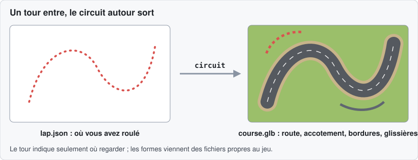
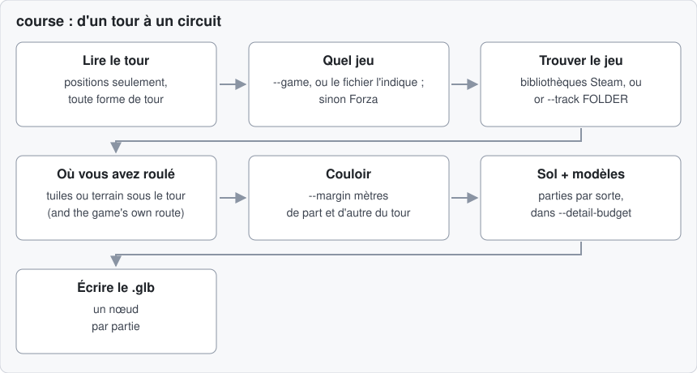

# Export de parcours {#course-export}

**En clair :** vous avez fait un tour ; ceci construit la piste que vous avez parcourue, sous
forme de fichier 3D. Le tour n'est qu'une suite de points ; la route, l'herbe et les bordures
viennent des fichiers propres au jeu.



`course` transforme un tour en parcours : le sol dans une bande de chaque côté de là où la
voiture est passée, et ce qui se dresse sur ce sol, dans un seul `.glb` pour le visualiseur. La
présente page décrit les étapes ; la page suivante décrit comment chacune se fait à partir des
fichiers du jeu :

- [Comment un parcours Forza est fait](course-forza-horizon.md) : trouver le jeu, la piste et la
  course ; terrain, texture de sol, modèles placés
- [Niveaux de détail et budget](https://holdi601.github.io/3DHeat-GameFiles/detail-budget.html) (sur le site de GameFiles) : combien de triangles reçoivent les modèles placés, et quelles copies restent

```
heat3d-forza-maps course "Example Circuit"
heat3d-forza-maps course lap.json -o example.glb
```

La seule chose dont il a besoin est le tour : l'endroit où le jeu est installé, la piste, la course
et l'endroit où découper sont tous déduits de lui.



## Les étapes {#the-steps}

Mots utilisés ci-dessous : un **repère** indique dans quel sens pointent les axes ; le **couloir**
est la bande de sol de chaque côté du tour ; une **tuile** est un morceau carré du terrain du jeu ;
un **LOD** (niveau de détail) est une des copies plus simples d'un modèle.

1. **Lire le tour.** Positions seulement, dans l'une des formes décrites dans
   [Entrées de tour](https://holdi601.github.io/3DHeat-GameFiles/lap-inputs.html). La vitesse et les
   commandes ne sont pas utilisées. Un tour de moins de deux points est refusé (« holds no driving »).
2. **Vérifier le jeu.** `--game`, puis le champ `game` du fichier de tour, puis Forza. Un tour de
   BeamNG.drive ou d'Assetto Corsa Rally est refusé, avec l'outil qui l'exporte (voir
   [Commandes](commands.md#which-game)).
3. **Trouver le jeu installé.** Chaque bibliothèque Steam listée dans le fichier
   `config\libraryfolders.vdf` de Steam est cherchée, ainsi que `C:\XboxGames` pour le Microsoft
   Store. `--track` saute la recherche.
4. **Trouver l'endroit où le tour a été fait.** Cela ne se décide jamais par la seule correspondance
   d'un nom : c'est la piste dont les tuiles de terrain couvrent le tour.
5. **Trouver la course.** Le tour est comparé à la ligne IA de chaque course que le jeu définit ; la
   course qu'il suit ajoute sa propre couche (barrières, tentes, portiques) et retire ce qu'elle cache.
6. **Découper un couloir** de `--margin` mètres de chaque côté de la conduite (voir plus bas), élargi
   à tout lieu que la conduite traverse.
7. **Construire le sol** dans le couloir, classé en route, accotement, terrain, marquages, traces de
   pneus ou eau, et cuire une texture de sol pour chaque tuile de 512 m.
8. **Placer les modèles** qui se trouvent dans le couloir, par catégorie, à un niveau de détail choisi
   selon la distance et un budget de triangles.
9. **Écrire le `.glb`** : un nœud nommé par partie. Voir [Format de sortie](https://holdi601.github.io/3DHeat-GameFiles/output-format.html).

Ce qu'affiche une exécution : ici sur une piste fictive que les tests construisent, un cercle de 30 m
autour d'une glissière et d'une bordure :


Sur une vraie piste, la commande indique aussi `on <track>, in <game folder>` et la course trouvée,
et les nombres se comptent en centaines de milliers de triangles.

## Le couloir {#the-corridor}

La découpe est une bande autour de la ligne conduite, et non la boîte englobante du tour. Pour un
circuit, les deux sont presque identiques. Pour un sprint d'un point à un autre, la boîte est surtout
du versant que personne ne traverse, et la bande peut ne faire qu'un dixième de sa surface. Source :
[`corridor.py`](https://github.com/Holdi601/3DHeat-GameFiles/blob/main/heat3d_gamefiles/corridor.py)
dans 3DHeat GameFiles.

Comment elle est construite :

- La conduite est projetée sur le plan du sol : x et z du tour.
- Elle est rastérisée sur une grille de cellules de **4 m** (`CELL`). Chaque cellule touchée par la
  conduite est élargie d'un disque de rayon `margin + 4 m` dans toutes les directions.
- Les points successifs à moins de **50 m** les uns des autres (`JOIN`) sont reliés par des points
  tous les 4 m, pour que la bande n'ait pas de trous. Les points plus éloignés sont considérés comme
  des tronçons séparés de conduite et ne sont pas reliés. Un circuit de la bibliothèque est fait de
  nombreux fichiers de tour bout à bout, et l'arrivée d'un sprint et le départ du suivant ne doivent
  pas tracer une bande d'un bout à l'autre de la carte.
- Un triangle est gardé si un de ses coins, le milieu d'une arête ou son centre de gravité est dans la
  bande. Les points du milieu attrapent un grand triangle qui traverse une bande étroite avec tous ses
  coins à l'extérieur.
- L'altitude n'entre jamais dans la découpe. Une boîte qui bornerait l'altitude couperait le sol sous
  une colline que la route gravit.

La console indique la surface du couloir, par exemple
`cutting 80 m either side of the driving: 1.53 km2 of a 6,000 by 3,600 m box`.

Quand la conduite traverse le sol propre d'un lieu (le sol d'un stade, un site de festival), le couloir
prend tout ce sol, si bien que les tribunes et les murs qui l'entourent viennent aussi (voir
[Un lieu est découpé en entier](course-forza-horizon.md#models-already-in-world-coordinates)).

## De quoi est fait le sol {#what-the-ground-is-made-of}

Chaque export classe ses triangles de sol dans les mêmes natures, et chaque nature est écrite comme sa
propre partie pour que le visualiseur puisse l'afficher ou la masquer :

| Nature | Nom de la partie | Couleur unie (RVB linéaire) | Ce que c'est |
|---|---|---|---|
| route | `ground:road` | 0.22, 0.22, 0.23 | bandes de route : la partie asphalte |
| accotement | `ground:verge` | 0.52, 0.47, 0.30 | bandes de route : l'accotement |
| terrain | `ground:terrain` | 0.30, 0.44, 0.18 | tout le reste |
| bordures | `ground:kerbs` | 0.60, 0.12, 0.10 | les accessoires `road_gen_rum*` |
| lieu | `ground:venue` | 0.33, 0.33, 0.34 | le sol propre d'un lieu : le sol d'un stade, un site de festival |
| plinthes | `ground:plinths` | 0.42, 0.41, 0.39 | sol dont une rue est habillée : bacs à plantes, marches, pavage |
| marquages | `ground:markings` | 0.90, 0.90, 0.88 | sous-maillages de décalques, relevés de 5 cm |
| traces de pneus | `ground:tyre marks` | 0.20, 0.17, 0.16 | sous-maillages de décalques, relevés de 5 cm |
| eau | `water:water` | 0.16, 0.34, 0.48 | matériaux d'eau |

Les couleurs unies sont choisies pour se lire d'un coup d'œil, non pour imiter le jeu. Elles servent
aux parties sans texture et aux visualiseurs qui ignorent les textures. Source :
[`surfaces.py`](https://github.com/Holdi601/3DHeat-GameFiles/blob/main/heat3d_gamefiles/surfaces.py).

La route, l'accotement et le terrain sont découpés par tuile de terrain de 512 m, et chaque tuile porte
sa propre image cuite. Le nom des parties contient donc le nom de grille de la tuile (pas de 1023, voir
[Comment un parcours Forza est fait](course-forza-horizon.md#terrain)), par exemple
`ground:road x-2046 z1023`.

## Ce qui se dresse dessus {#what-stands-on-it}

Les modèles placés sont écrits dans des parties nommées `structure:<category>`, ou `ground:kerbs` pour
les bordures. Quand une partie a sa propre texture, le nom de la texture ou du matériau suit la
catégorie, par exemple `structure:barriers bar_armco_bclr`.

| Catégorie | Placée |
|---|---|
| barrières, accessoires, panneaux, infrastructure, rochers | oui |
| bâtiments | oui (bâtiments entiers de substitution là où le jeu en a) |
| ponts | oui |
| bordures | oui, comme sol |
| arbres, buissons, objets destructibles | avec `--trees` |
| la couche propre à la course | `structure:event_<category>`, quand le tour suit une course du jeu |
| autres couches allumées | `structure:layer_<category>` |

La répartition des détails : les copies situées à moins de 25 m de la conduite gardent tout leur
détail, les copies à 25-60 m descendent d'un cran, et les copies plus loin passent au niveau le plus
grossier. Ensuite, les modèles les plus coûteux descendent jusqu'à ce qu'un budget de triangles tienne,
et là où même les niveaux les plus grossiers ne tiennent pas dans un budget que vous donnez, des copies
sont laissées de côté. Les bordures ne sont jamais simplifiées ni laissées de côté. Voir
[Niveaux de détail et budget](https://holdi601.github.io/3DHeat-GameFiles/detail-budget.html).

## Les options qui changent le résultat {#options-that-shape-the-result}

| Vous voulez | Utilisez |
|---|---|
| un fichier plus petit | `--no-textures` (couleurs unies), `--texture-size 1024` ou `512`, `--detail-budget N`, `--margin 40` |
| seulement le sol | `--no-placed` |
| le décor aussi | `--trees` |
| une autre saison | `--season winter` |
| un jeu installé dans un endroit où il n'est pas cherché | `--track` |
| un tour que la recherche ne place pas | `--track` |

## Coordonnées {#coordinates}

Le parcours est écrit dans les coordonnées du monde du jeu, sans changement : mètres, Y vers le haut,
le repère que la télémétrie du jeu rapporte, si bien qu'un tour enregistré s'y pose sans placement ni
mise à l'échelle. Voir [Format de sortie](https://holdi601.github.io/3DHeat-GameFiles/output-format.html).
