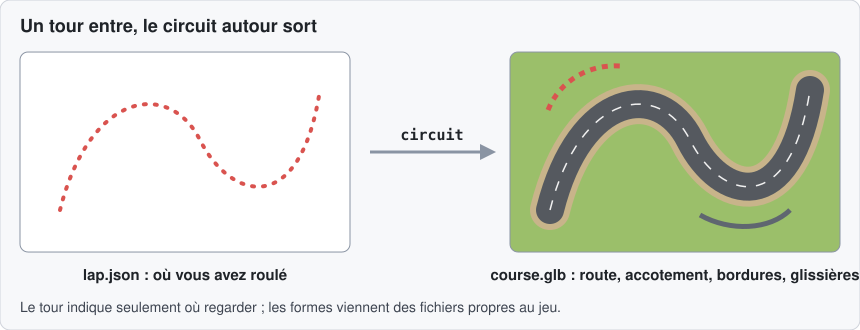

# 3DHeat Forza {#dheat-forza}

**Qu'est-ce que c'est ?** Un outil qui construit un modèle 3D d'une piste de course Forza à
partir du Forza que vous avez déjà installé : vous lui donnez un tour que vous avez roulé, et
il écrit la route, l'accotement et l'herbe, les bordures, les barrières, les murs de pneus, les
panneaux et les bâtiments qui l'entourent, dans un seul fichier 3D.

**À quoi cela sert-il ?** Le visualiseur [3DHeat](https://github.com/Holdi601/3DHeat)
([documentation](https://holdi601.github.io/3DHeat/)) colore en chaleur les endroits où vous
êtes passé, et son onglet Analyse de course compare les tours virage par virage. Avec cet outil,
ces tours sont peints sur la vraie piste, et non sur du vide, et chaque voiture enregistrée est
dessinée dans sa propre forme.

**Exemple :** `heat3d-forza-maps course "Example Circuit"` trouve le jeu, la piste et la course
sur laquelle les tours ont été faits, et écrit `example_circuit.glb` :



Il lit Forza Horizon et Forza Motorsport, les jeux qui utilisent le moteur ForzaTech de Turn 10,
installés par Steam ou le Microsoft Store. Paquet Python : `heat3d_ext_forza`. Dépôt :
[Holdi601/3DHeat-Ext-Forza](https://github.com/Holdi601/3DHeat-Ext-Forza). Licence : MIT.

Chaque lecteur de jeu est un petit projet à part, avec son propre fichier de licence, ses propres versions et son propre suivi des tickets : il peut être installé, mis à jour, maintenu - ou retiré à la demande d'un ayant droit - seul, sans toucher au visualiseur ni aux autres outils.

Ce qu'il écrit reste sur votre machine ([Conditions](terms.md)).

## Démarrage rapide {#quick-start}

Vous ne connaissez pas la ligne de commande ? Lisez d'abord [Avant de commencer](before-you-start.md).
Il vous faut Python 3.10 ou plus récent, et un Forza installé par Steam ou le Microsoft Store.

```
git clone https://github.com/Holdi601/3DHeat-Ext-Forza.git
cd 3DHeat-Ext-Forza
python -m pip install -e .                      # la commande heat3d-forza-maps, et 3DHeat GameFiles
heat3d-forza-maps course "Example Circuit"      # un parcours de la bibliothèque de tours FH Companion, par son nom
heat3d-forza-maps cars                          # toutes les voitures, pour l'onglet Analyse de course
```

`course` se termine par `wrote example_circuit.glb (... bytes)`. Chargez le fichier dans le
panneau **Arrière-plan / niveau** du visualiseur avec **Modèle 3D…** ; chargez le fichier de
voitures avec **Charger le fichier de voitures…** dans les réglages d'affichage de l'onglet
Analyse de course.

## Ce que fait l'outil {#what-it-does}

| Commande | Fait | Page |
|---|---|---|
| `course <lap>` | la piste autour d'un tour : le sol avec la route et l'accotement distingués, une texture de sol, chaque modèle placé dans sa propre texture, la couche propre à la course | [Export de parcours](course-export.md), [Comment un parcours Forza est fait](course-forza-horizon.md) |
| `courses` | `course` pour chaque parcours d'une bibliothèque de tours enregistrés | [Commandes](commands.md#courses) |
| `races` | chaque course que le jeu définit, et si vos exports de celle-ci sont à jour | [Commandes](commands.md#races) |
| `terrain <track>` | un morceau de piste à partir de coordonnées du monde, sans tour | [Commandes](commands.md#terrain) |
| `cars` | chaque voiture à faible détail, dans un seul fichier pour le visualiseur | [Voitures Forza](forza-cars.md) |
| `identify`, `list`, `extract` | ce qu'est un fichier Forza, ce que contient un `.minizip`, une entrée extraite | [Inspecter les fichiers Forza](inspecting-files.md) |

La façon dont les fichiers du jeu sont lus, octet par octet : [ForzaTech](reader-forzatech.md).
Toutes les options : [Référence des commandes](../cli-reference.md).

L'outil repose sur [3DHeat GameFiles](https://holdi601.github.io/3DHeat-GameFiles/), qui fournit
l'écrivain glTF, les lecteurs de tours, le couloir et le budget de détail, et qui lance cet outil
pour ses propres commandes `course`, `courses`, `races`, `cars` et `terrain` sur un tour Forza.
Pages de GameFiles qui valent aussi ici :
[Entrées de tour](https://holdi601.github.io/3DHeat-GameFiles/lap-inputs.html),
[Niveaux de détail et budget](https://holdi601.github.io/3DHeat-GameFiles/detail-budget.html),
[Format de sortie](https://holdi601.github.io/3DHeat-GameFiles/output-format.html),
[Limites et lacunes connues](https://holdi601.github.io/3DHeat-GameFiles/limits-and-known-gaps.html).

## Pages {#pages}

| Page | Ce qu'elle couvre |
|---|---|
| [Avant de commencer](before-you-start.md) | Python, un terminal, l'installation, un premier lancement |
| [Commandes](commands.md) | chaque commande, ses options, ses codes de sortie |
| [Export de parcours](course-export.md) | `course` étape par étape : le couloir, le sol, ce qui s'y dresse |
| [Comment un parcours Forza est fait](course-forza-horizon.md) | trouver le jeu, la piste, la course ; terrain, textures, modèles placés |
| [Voitures Forza](forza-cars.md) | `cars` et le fichier de voitures |
| [Inspecter les fichiers Forza](inspecting-files.md) | `identify`, `list`, `extract` |
| [ForzaTech](reader-forzatech.md) | les formats de fichiers |
| [Conditions et licence](terms.md) | les fichiers du jeu, ce que vous pouvez faire de la sortie |
| [Référence des commandes](../cli-reference.md) | chaque option, générée à partir du code |
| [Maintenance de ces documents](maintaining.md) | tests et liste de publication |

## Les outils 3DHeat {#the-3dheat-tools}

| Outil | Ce qu'il fait | Code | Documentation |
|---|---|---|---|
| visualiseur 3DHeat | affiche les données : cartes de chaleur, analyse de course, revue de partie | [3DHeat](https://github.com/Holdi601/3DHeat) | [documentation](https://holdi601.github.io/3DHeat/) |
| GameFiles | niveaux et parcours à partir des fichiers propres d'un jeu | [3DHeat-GameFiles](https://github.com/Holdi601/3DHeat-GameFiles) | [documentation](https://holdi601.github.io/3DHeat-GameFiles/) |
| GameCapture | télémétrie des tours, et niveaux reconstruits à partir de vidéos de partie | [3DHeat-GameCapture](https://github.com/Holdi601/3DHeat-GameCapture) | [documentation](https://holdi601.github.io/3DHeat-GameCapture/) |
| Unreal Exporter | un plugin de l'éditeur Unreal : un niveau en un seul `.glb` | [3DHeat-UnrealExporter](https://github.com/Holdi601/3DHeat-UnrealExporter) | [documentation](https://holdi601.github.io/3DHeat-UnrealExporter/) |
| CS2 | démos et cartes de Counter-Strike 2 | [3DHeat-CS2](https://github.com/Holdi601/3DHeat-CS2) | [documentation](https://holdi601.github.io/3DHeat-CS2/) |
| Watcher | enregistre ce que les jeux publient pendant que vous jouez | [3DHeat-Watcher](https://github.com/Holdi601/3DHeat-Watcher) | [documentation](https://holdi601.github.io/3DHeat-Watcher/) |
| Ext-WarThunder | replays de War Thunder | [3DHeat-Ext-WarThunder](https://github.com/Holdi601/3DHeat-Ext-WarThunder) | [documentation](https://holdi601.github.io/3DHeat-Ext-WarThunder/) |
| Ext-WoT | replays de World of Tanks | [3DHeat-Ext-WoT](https://github.com/Holdi601/3DHeat-Ext-WoT) | [documentation](https://holdi601.github.io/3DHeat-Ext-WoT/) |
| Ext-WoWs | replays de World of Warships | [3DHeat-Ext-WoWs](https://github.com/Holdi601/3DHeat-Ext-WoWs) | [documentation](https://holdi601.github.io/3DHeat-Ext-WoWs/) |
| Ext-Squad | démos de serveur Squad | [3DHeat-Ext-Squad](https://github.com/Holdi601/3DHeat-Ext-Squad) | [documentation](https://holdi601.github.io/3DHeat-Ext-Squad/) |
| Ext-DCS | cartes de DCS World en niveaux 3D | [3DHeat-Ext-DCS](https://github.com/Holdi601/3DHeat-Ext-DCS) | [documentation](https://holdi601.github.io/3DHeat-Ext-DCS/) |
| Ext-IL2 | cartes d'IL-2 Sturmovik en niveaux 3D | [3DHeat-Ext-IL2](https://github.com/Holdi601/3DHeat-Ext-IL2) | [documentation](https://holdi601.github.io/3DHeat-Ext-IL2/) |
| Ext-Dota | la carte de Dota 2 en niveau 3D | [3DHeat-Ext-Dota](https://github.com/Holdi601/3DHeat-Ext-Dota) | [documentation](https://holdi601.github.io/3DHeat-Ext-Dota/) |
| Ext-DotaReplay | replays de Dota 2 | [3DHeat-Ext-DotaReplay](https://github.com/Holdi601/3DHeat-Ext-DotaReplay) | [documentation](https://holdi601.github.io/3DHeat-Ext-DotaReplay/) |
| Ext-Riot | replays de League of Legends et Valorant | [3DHeat-Ext-Riot](https://github.com/Holdi601/3DHeat-Ext-Riot) | [documentation](https://holdi601.github.io/3DHeat-Ext-Riot/) |
| **Ext-Forza** | **parcours, courses et voitures Forza à partir de votre propre installation** | [3DHeat-Ext-Forza](https://github.com/Holdi601/3DHeat-Ext-Forza) | [documentation](https://holdi601.github.io/3DHeat-Ext-Forza/) |
| Ext-Battlefield | niveaux de Battlefield 6 à partir de votre propre installation | [3DHeat-Ext-Battlefield](https://github.com/Holdi601/3DHeat-Ext-Battlefield) | [documentation](https://holdi601.github.io/3DHeat-Ext-Battlefield/) |
| Ext-BeamNG | parcours de BeamNG.drive à partir de votre propre installation | [3DHeat-Ext-BeamNG](https://github.com/Holdi601/3DHeat-Ext-BeamNG) | [documentation](https://holdi601.github.io/3DHeat-Ext-BeamNG/) |
| Ext-ACRally | étapes d'Assetto Corsa Rally à partir de votre propre installation | [3DHeat-Ext-ACRally](https://github.com/Holdi601/3DHeat-Ext-ACRally) | [documentation](https://holdi601.github.io/3DHeat-Ext-ACRally/) |
| Ext-Reforger | mondes d'Arma Reforger à partir de votre propre installation | [3DHeat-Ext-Reforger](https://github.com/Holdi601/3DHeat-Ext-Reforger) | [documentation](https://holdi601.github.io/3DHeat-Ext-Reforger/) |
| Ext-R6 | replays de matchs Rainbow Six Siege | [3DHeat-Ext-R6](https://github.com/Holdi601/3DHeat-Ext-R6) | [documentation](https://holdi601.github.io/3DHeat-Ext-R6/) |
