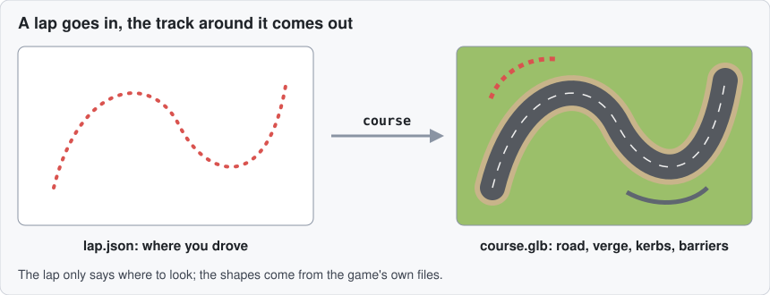

# 3DHeat Forza

**What is it?** A tool that builds a 3D model of a Forza race track from the
Forza you already have installed: you give it a lap you drove, and it writes the
road, the verge and grass, the kerbs, barriers, tyre walls, signs and buildings
around it as one 3D file.

**Why would I use it?** The [3DHeat](https://github.com/Holdi601/3DHeat) viewer
([documentation](https://holdi601.github.io/3DHeat/)) paints where you drove as
heat, and its Race analysis tab compares laps corner by corner. With this tool
it paints them on the real track, not on empty space, and draws every recorded
car in its own shape.

**Example:** `heat3d-forza-maps course "Example Circuit"` finds the game, the
track, the race the laps were driven on, and writes `example_circuit.glb`:



It reads Forza Horizon and Forza Motorsport, the games on Turn 10's ForzaTech
engine, from Steam or the Microsoft Store. Python package: `heat3d_ext_forza`.
Repository: [Holdi601/3DHeat-Ext-Forza](https://github.com/Holdi601/3DHeat-Ext-Forza).
Licence: MIT.

Each game reader is its own small project with its own licence file, releases
and issue tracker, so it can be installed, updated, maintained - or withdrawn
on a rights holder's request - on its own, without affecting the viewer or the
other tools.

What it writes stays on your machine ([Terms](terms.md)).

## Quick start

You need Windows, Python 3.10 or later ("Add python.exe to PATH" ticked in its
installer), a Forza Horizon or Forza Motorsport installed through Steam or the
Microsoft Store (found by itself) and a lap you drove; no Git. New to the
command line? Read [Before you start](before-you-start.md) first.

```bash
python -m pip install https://github.com/Holdi601/3DHeat-Ext-Forza/archive/refs/tags/v1.0.0.zip
heat3d-forza-maps course laps\<lap>.lap.json -o my_course.glb    # the track around a recorded lap
heat3d-forza-maps course "<course name>"                         # or a course of the FH Companion library, by name
heat3d-forza-maps cars                                           # every car, for the Race analysis tab
```

The install brings [3DHeat GameFiles](https://holdi601.github.io/3DHeat-GameFiles/),
the library it reads with. A lap comes from
[3DHeat GameCapture](https://github.com/Holdi601/3DHeat-GameCapture) (turn on
the game's Data Out to `127.0.0.1`, port `5300`, then
`python -m heat3d_capture telemetry -o laps`), or from the FH Companion lap
library (`%LOCALAPPDATA%\FHCompanion\laps`, found by itself). `course` says
which track and race it found and ends with `wrote my_course.glb (... bytes)`;
without `-o` the file is named after the course (`"Example Circuit"` ->
`example_circuit.glb`). `cars` writes `forza.h3dcars` (about 5 MB, in seconds).
Both land in the folder you ran them in.

Then open them in the [3DHeat viewer](https://github.com/Holdi601/3DHeat#quick-start):
download it (**Code -> Download ZIP**, unpack), double-click `start.bat` (it
offers to install Node.js when it is missing and opens `http://127.0.0.1:5273`),
then **Background / level -> 3D model...** and pick the `.glb`; in the
**Race analysis** tab **Load lap files...** and pick your laps, and
**Load car file...** (in the tab's view settings) and pick `forza.h3dcars`.

When a new release is out, the tool says so when it starts and offers to
update itself.

## What it does

| Command | Does | Page |
|---|---|---|
| `course <lap>` | the track around a lap: ground with road and verge told apart, a ground texture, every placed model in its own texture, the race's own layer | [Course export](course-export.md), [How a Forza course is made](course-forza-horizon.md) |
| `courses` | `course` for every course in a recorded lap library | [Commands](commands.md#courses) |
| `races` | every race the game defines, and whether your exports of it are current | [Commands](commands.md#races) |
| `terrain <track>` | a piece of track by world coordinates, no lap needed | [Commands](commands.md#terrain) |
| `cars` | every car at low detail, in one file for the viewer | [Forza cars](forza-cars.md) |
| `catalog` | the car list with classes, index and drivetrain | [Car catalogue](forza-catalog.md) |
| `identify`, `list`, `extract` | what a Forza file is, what a `.minizip` holds, one entry out | [Inspecting Forza files](inspecting-files.md) |

How the game's files are read, byte by byte: [ForzaTech](reader-forzatech.md).
Every option: [Command reference](cli-reference.md).

It is built on [3DHeat GameFiles](https://holdi601.github.io/3DHeat-GameFiles/),
which supplies the glTF writer, the lap readers, the corridor and the detail
budget, and which runs this tool for its own `course`, `courses`, `races`,
`cars` and `terrain` commands on a Forza lap. Pages there that apply here too:
[Lap inputs](https://holdi601.github.io/3DHeat-GameFiles/lap-inputs.html),
[Levels of detail and the budget](https://holdi601.github.io/3DHeat-GameFiles/detail-budget.html),
[Output format](https://holdi601.github.io/3DHeat-GameFiles/output-format.html),
[Limits and known gaps](https://holdi601.github.io/3DHeat-GameFiles/limits-and-known-gaps.html).

## Pages

| Page | What it covers |
|---|---|
| [Before you start](before-you-start.md) | Python, a terminal, installing, a first run |
| [Commands](commands.md) | every command, its options, exit codes |
| [Course export](course-export.md) | `course` step by step: the corridor, the ground, what stands on it |
| [How a Forza course is made](course-forza-horizon.md) | finding the game, the track, the race; terrain, textures, placed models |
| [Forza cars](forza-cars.md) | `cars` and the car file |
| [Inspecting Forza files](inspecting-files.md) | `identify`, `list`, `extract` |
| [ForzaTech](reader-forzatech.md) | the file formats |
| [Terms and licence](terms.md) | the game's files, what you may do with the output |
| [Command reference](cli-reference.md) | every option, generated from the code |
| [Maintaining these docs](maintaining.md) | tests and the release checklist |

## The 3DHeat tools

| Tool | What it does | Code | Docs |
|---|---|---|---|
| 3DHeat viewer | shows the data: heatmaps, race analysis, match review | [3DHeat](https://github.com/Holdi601/3DHeat) | [docs](https://holdi601.github.io/3DHeat/) |
| GameFiles | levels and courses from a game's own files | [3DHeat-GameFiles](https://github.com/Holdi601/3DHeat-GameFiles) | [docs](https://holdi601.github.io/3DHeat-GameFiles/) |
| GameCapture | lap telemetry, and levels rebuilt from gameplay video | [3DHeat-GameCapture](https://github.com/Holdi601/3DHeat-GameCapture) | [docs](https://holdi601.github.io/3DHeat-GameCapture/) |
| Unreal Exporter | an Unreal Editor plugin: a level as one `.glb` | [3DHeat-UnrealExporter](https://github.com/Holdi601/3DHeat-UnrealExporter) | [docs](https://holdi601.github.io/3DHeat-UnrealExporter/) |
| CS2 | Counter-Strike 2 demos and maps | [3DHeat-CS2](https://github.com/Holdi601/3DHeat-CS2) | [docs](https://holdi601.github.io/3DHeat-CS2/) |
| Watcher | records what games publish while you play | [3DHeat-Watcher](https://github.com/Holdi601/3DHeat-Watcher) | [docs](https://holdi601.github.io/3DHeat-Watcher/) |
| Ext-WarThunder | War Thunder replays | [3DHeat-Ext-WarThunder](https://github.com/Holdi601/3DHeat-Ext-WarThunder) | [docs](https://holdi601.github.io/3DHeat-Ext-WarThunder/) |
| Ext-WoT | World of Tanks replays | [3DHeat-Ext-WoT](https://github.com/Holdi601/3DHeat-Ext-WoT) | [docs](https://holdi601.github.io/3DHeat-Ext-WoT/) |
| Ext-WoWs | World of Warships replays | [3DHeat-Ext-WoWs](https://github.com/Holdi601/3DHeat-Ext-WoWs) | [docs](https://holdi601.github.io/3DHeat-Ext-WoWs/) |
| Ext-Squad | Squad server demos | [3DHeat-Ext-Squad](https://github.com/Holdi601/3DHeat-Ext-Squad) | [docs](https://holdi601.github.io/3DHeat-Ext-Squad/) |
| Ext-DCS | DCS World maps as 3D levels | [3DHeat-Ext-DCS](https://github.com/Holdi601/3DHeat-Ext-DCS) | [docs](https://holdi601.github.io/3DHeat-Ext-DCS/) |
| Ext-IL2 | IL-2 Sturmovik maps as 3D levels | [3DHeat-Ext-IL2](https://github.com/Holdi601/3DHeat-Ext-IL2) | [docs](https://holdi601.github.io/3DHeat-Ext-IL2/) |
| Ext-Dota | the Dota 2 map as a 3D level | [3DHeat-Ext-Dota](https://github.com/Holdi601/3DHeat-Ext-Dota) | [docs](https://holdi601.github.io/3DHeat-Ext-Dota/) |
| Ext-DotaReplay | Dota 2 replays | [3DHeat-Ext-DotaReplay](https://github.com/Holdi601/3DHeat-Ext-DotaReplay) | [docs](https://holdi601.github.io/3DHeat-Ext-DotaReplay/) |
| Ext-Riot | League of Legends and Valorant replays | [3DHeat-Ext-Riot](https://github.com/Holdi601/3DHeat-Ext-Riot) | [docs](https://holdi601.github.io/3DHeat-Ext-Riot/) |
| **Ext-Forza** | **Forza courses, races and cars from your own install** | [3DHeat-Ext-Forza](https://github.com/Holdi601/3DHeat-Ext-Forza) | [docs](https://holdi601.github.io/3DHeat-Ext-Forza/) |
| Ext-Battlefield | Battlefield 6 levels from your own install | [3DHeat-Ext-Battlefield](https://github.com/Holdi601/3DHeat-Ext-Battlefield) | [docs](https://holdi601.github.io/3DHeat-Ext-Battlefield/) |
| Ext-BeamNG | BeamNG.drive courses from your own install | [3DHeat-Ext-BeamNG](https://github.com/Holdi601/3DHeat-Ext-BeamNG) | [docs](https://holdi601.github.io/3DHeat-Ext-BeamNG/) |
| Ext-ACRally | Assetto Corsa Rally stages from your own install | [3DHeat-Ext-ACRally](https://github.com/Holdi601/3DHeat-Ext-ACRally) | [docs](https://holdi601.github.io/3DHeat-Ext-ACRally/) |
| Ext-Reforger | Arma Reforger worlds from your own install | [3DHeat-Ext-Reforger](https://github.com/Holdi601/3DHeat-Ext-Reforger) | [docs](https://holdi601.github.io/3DHeat-Ext-Reforger/) |
| Ext-R6 | Rainbow Six Siege match replays | [3DHeat-Ext-R6](https://github.com/Holdi601/3DHeat-Ext-R6) | [docs](https://holdi601.github.io/3DHeat-Ext-R6/) |
