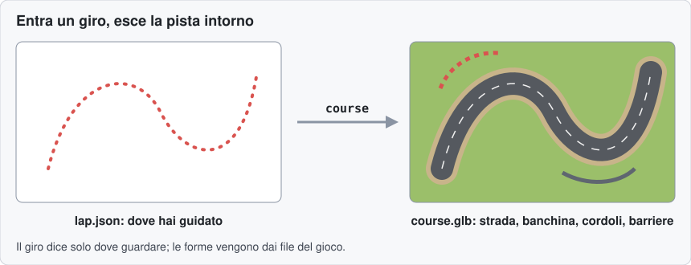
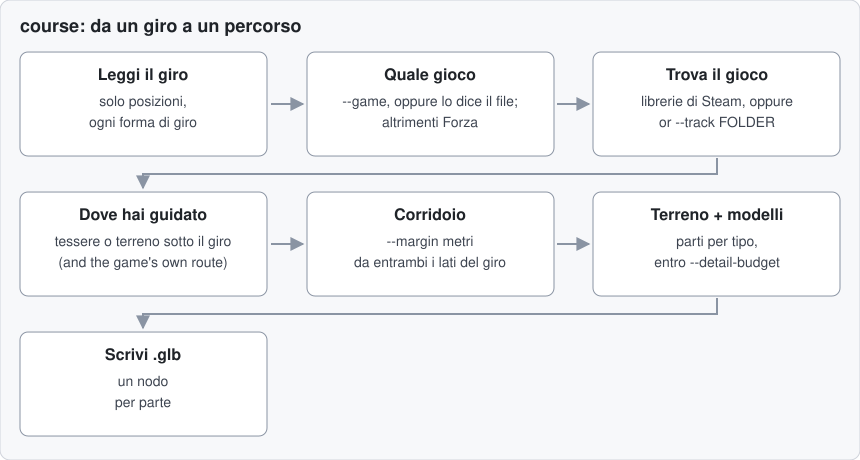
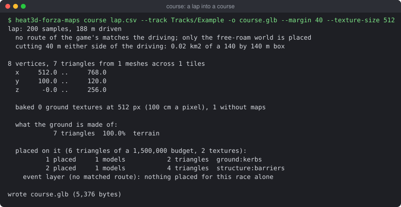

# Esportazione del percorso {#course-export}

**In parole semplici:** hai guidato un giro; questo costruisce la pista su cui hai guidato,
come file 3D. Il giro è solo una serie di punti; la strada, l'erba e i cordoli vengono
dai file del gioco stesso.



`course` trasforma un giro in un percorso: il suolo in una fascia su entrambi i lati del
punto in cui è passata l'auto, e ciò che sta su quel suolo, in un unico `.glb` per il
visualizzatore. Questa pagina descrive i passaggi. La pagina sotto spiega come ciascuno
viene svolto nei file del gioco:

- [Come nasce un percorso Forza](course-forza-horizon.md): trovare il gioco, il tracciato e la gara; terreno, texture del suolo, modelli collocati
- [Livelli di dettaglio e budget](https://holdi601.github.io/3DHeat-GameFiles/detail-budget.html) (sul sito di GameFiles): quanti triangoli ricevono i modelli collocati, e quali copie restano

```
heat3d-forza-maps course "Example Circuit"
heat3d-forza-maps course lap.json -o example.glb
```

L'unica cosa che serve è il giro: dove è installato il gioco, quale tracciato, quale
gara e dove tagliare, tutto viene ricavato da lui.



## I passaggi {#the-steps}

Termini usati qui sotto: un **frame** è la direzione degli assi; il **corridoio** è la
fascia di suolo su entrambi i lati del giro; un **tassello** è un pezzo quadrato del
terreno di un gioco; un **LOD** (livello di dettaglio) è una delle copie più semplici di un modello.

1. **Leggi il giro.** Solo le posizioni, da una qualsiasi delle forme in
   [Input dei giri](https://holdi601.github.io/3DHeat-GameFiles/lap-inputs.html). Velocità e comandi non vengono usati. Un giro con meno di
   due campioni viene rifiutato ("holds no driving").
2. **Controlla il gioco.** `--game`, poi il campo `game` del file del giro, poi Forza. Un giro
   di BeamNG.drive o di Assetto Corsa Rally viene rifiutato, con lo strumento che lo esporta
   (vedi [Comandi](commands.md#which-game)).
3. **Trova il gioco installato.** Ogni libreria Steam elencata nel file
   `config\libraryfolders.vdf` di Steam viene cercata, e `C:\XboxGames` per il Microsoft Store.
   `--track` salta la ricerca.
4. **Trova dove è stato guidato il giro.** Questo non viene mai deciso da una corrispondenza
   di nome: è tracciato quello i cui tasselli di terreno coprono il giro.
5. **Trova la gara.** Il giro viene confrontato con la linea AI di ogni gara che il gioco
   definisce; la gara che segue aggiunge il proprio layer (barriere, tende, portali) e toglie
   ciò che nasconde.
6. **Ritaglia un corridoio** di `--margin` metri su entrambi i lati della guida (sotto),
   allargato a tutta l'area di qualsiasi location che la guida attraversa.
7. **Costruisci il suolo** dentro il corridoio, classificato come strada, banchina, terreno,
   segnaletica, segni di pneumatici o acqua, e cuoci una texture del suolo per ogni tassello di 512 m.
8. **Colloca i modelli** che stanno nel corridoio, per categoria, a un livello di dettaglio
   scelto in base alla distanza e a un budget di triangoli.
9. **Scrivi il `.glb`**: un nodo con nome per ogni parte. Vedi [Formato di output](https://holdi601.github.io/3DHeat-GameFiles/output-format.html).

Cosa stampa un'esecuzione - qui su un tracciato inventato che i test costruiscono, un
cerchio di 30 m attorno a un guardrail e a un cordolo:



Su un tracciato vero stampa anche `on <tracciato>, in <cartella del gioco>` e quale gara
ha trovato, e i conteggi arrivano a centinaia di migliaia di triangoli.

## Il corridoio {#the-corridor}

Il ritaglio è una fascia attorno alla linea guidata, non il riquadro che racchiude il
giro. Per un circuito i due sono quasi uguali. Per una corsa da un punto all'altro il
riquadro è per lo più pendio che nessuno percorre, e la fascia può valere un decimo della
sua area. Sorgente: [`corridor.py`](https://github.com/Holdi601/3DHeat-GameFiles/blob/main/heat3d_gamefiles/corridor.py) in 3DHeat GameFiles.

Come viene costruito:

- La guida viene proiettata sul piano del suolo: x e z del giro.
- Viene rasterizzata su una griglia di celle da **4 m** (`CELL`). Ogni cella toccata dalla guida
  viene allargata da un disco di raggio `margin + 4 m` in ogni direzione.
- I campioni consecutivi distanti meno di **50 m** (`JOIN`) vengono uniti da punti ogni 4 m,
  così la fascia non ha buchi. I campioni più distanti vengono trattati come tratti di guida
  separati e non vengono uniti. Una libreria di percorsi è molti file di giro uno dopo l'altro,
  e l'arrivo di uno sprint e la partenza del successivo non devono disegnare una fascia
  attraverso la mappa.
- Un triangolo viene tenuto se un angolo, il centro di un lato o il baricentro sta nella
  fascia. I punti medi catturano un triangolo grande che attraversa una fascia stretta con
  tutti gli angoli fuori.
- L'altezza non fa parte del ritaglio. Un riquadro che limitasse l'altitudine taglierebbe via
  il suolo sotto una collina che la strada sale.

La console riporta l'area del corridoio, per esempio
`cutting 80 m either side of the driving: 1.53 km2 of a 6,000 by 3,600 m box`.

Dove la guida attraversa il suolo proprio di una location (la pista di uno stadio, un
sito di un festival), il corridoio include tutto quel suolo, così arrivano anche le tribune
e i muri attorno (vedi [A venue is cut whole](course-forza-horizon.md#models-already-in-world-coordinates)).

## Di che cosa è fatto il suolo {#what-the-ground-is-made-of}

Ogni esportazione classifica i suoi triangoli di suolo negli stessi tipi, e ogni tipo viene
scritto come parte propria, così il visualizzatore può mostrarlo o nasconderlo:

| Tipo | Nome della parte | Colore piatto (RGB lineare) | Cos'è |
|---|---|---|---|
| strada | `ground:road` | 0.22, 0.22, 0.23 | strisce di strada: la parte in asfalto |
| banchina | `ground:verge` | 0.52, 0.47, 0.30 | strisce di strada: la spalla |
| terreno | `ground:terrain` | 0.30, 0.44, 0.18 | tutto il resto |
| cordoli | `ground:kerbs` | 0.60, 0.12, 0.10 | props `road_gen_rum*` |
| location | `ground:venue` | 0.33, 0.33, 0.34 | il suolo proprio di una location: la pista di uno stadio, un sito di un festival |
| basamenti | `ground:plinths` | 0.42, 0.41, 0.39 | suolo con cui una strada è arredata: fioriere, gradini, pavimentazioni |
| segnaletica | `ground:markings` | 0.90, 0.90, 0.88 | sottomesh di decalcomania, sollevate di 5 cm |
| segni di pneumatici | `ground:tyre marks` | 0.20, 0.17, 0.16 | sottomesh di decalcomania, sollevate di 5 cm |
| acqua | `water:water` | 0.16, 0.34, 0.48 | materiali dell'acqua |

I colori piatti sono scelti per leggersi a colpo d'occhio, non per somigliare al gioco.
Vengono usati per le parti senza texture e dai visualizzatori che ignorano le texture.
Sorgente: [`surfaces.py`](https://github.com/Holdi601/3DHeat-GameFiles/blob/main/heat3d_gamefiles/surfaces.py).

Strada, banchina e terreno sono divisi per tassello di 512 m, e ogni tassello porta la
propria immagine cotta, quindi i nomi delle parti portano la chiave della griglia del
tassello, per esempio `ground:road x-2046 z1023` (passi di 1023, vedi
[Come nasce un percorso Forza](course-forza-horizon.md#terrain)).

## Ciò che sta sul suolo {#what-stands-on-it}

I modelli collocati sono scritti in parti `structure:<categoria>`, oppure `ground:kerbs`
per i cordoli. Quando una parte ha una propria texture, il nome della texture o del
materiale segue la categoria, per esempio `structure:barriers bar_armco_bclr`.

| Categoria | Collocata |
|---|---|
| barriere, oggetti di scena, cartelli, infrastrutture, ponti, rocce | sì |
| edifici | sì (sostituti di edificio intero dove il gioco li ha) |
| cordoli | sì, come suolo |
| alberi, cespugli, oggetti da frantumare | con `--trees` |
| il layer della gara stessa | `structure:event_<categoria>`, quando il giro segue una delle gare del gioco |
| altri layer attivati | `structure:layer_<categoria>` |

Come viene ripartito il dettaglio: le copie entro 25 m dalla guida partono a pieno
dettaglio, le copie a 25-60 m un livello più grossolane, e quelle più lontane al livello
più grossolano. Poi i modelli più costosi scendono di livello finché non rientra un budget
di triangoli, e dove anche i livelli più grossolani non rientrano in un budget che dai tu,
le copie vengono escluse. I cordoli non vengono mai semplificati né esclusi, perché un
giro viene misurato proprio su di essi. Vedi [Livelli di dettaglio e budget](https://holdi601.github.io/3DHeat-GameFiles/detail-budget.html).

## Opzioni che modificano il risultato {#options-that-shape-the-result}

| Vuoi | Usa |
|---|---|
| un file più piccolo | `--no-textures` (colori piatti), `--texture-size 1024` o `512`, `--detail-budget N`, `--margin 40` |
| solo il suolo | `--no-placed` |
| anche lo scenario | `--trees` |
| un'altra stagione | `--season winter` |
| un gioco installato dove non viene cercato | `--track` |
| un giro che la ricerca non colloca | `--track` |

## Coordinate {#coordinates}

Il percorso è scritto nelle coordinate del mondo del gioco, senza modifiche: metri, Y in
alto, il sistema di riferimento che la telemetria del gioco riporta, quindi un giro
registrato si allinea sul percorso senza alcuno spostamento o ridimensionamento. Vedi
[Formato di output](https://holdi601.github.io/3DHeat-GameFiles/output-format.html).
