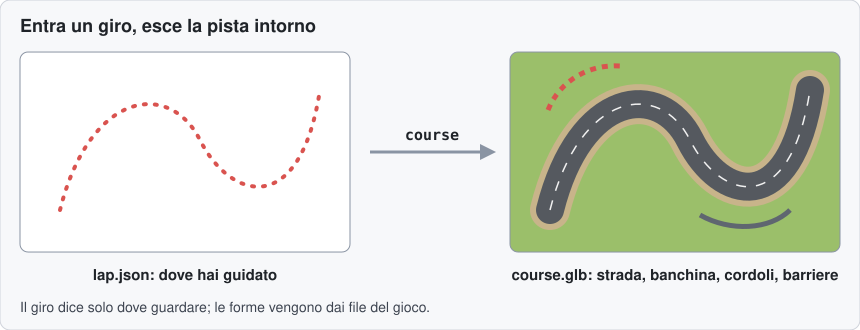

# 3DHeat Forza {#dheat-forza}

**Cos'è?** Uno strumento che costruisce un modello 3D di un tracciato di Forza a partire dal
Forza che hai già installato: gli dai un giro che hai guidato, e scrive la strada, la banchina
e l'erba, i cordoli, le barriere, i muri di pneumatici, i cartelli e gli edifici attorno ad
essa, in un unico file 3D.

**Perché usarlo?** Il visualizzatore [3DHeat](https://github.com/Holdi601/3DHeat)
([documentazione](https://holdi601.github.io/3DHeat/)) dipinge dove hai guidato come calore, e
la sua scheda Analisi di gara confronta i giri curva per curva. Con questo strumento li dipinge
sul tracciato vero, non nel vuoto, e disegna ogni auto registrata nella sua forma.

**Esempio:** `heat3d-forza-maps course "Example Circuit"` trova il gioco, il tracciato, la gara
su cui sono stati guidati i giri, e scrive `example_circuit.glb`:



Legge Forza Horizon e Forza Motorsport, i giochi sul motore ForzaTech di Turn 10, da Steam o
dal Microsoft Store. Pacchetto Python: `heat3d_ext_forza`. Repository:
[Holdi601/3DHeat-Ext-Forza](https://github.com/Holdi601/3DHeat-Ext-Forza). Licenza: MIT.

Ogni lettore di gioco è un piccolo progetto a sé, con il proprio file di licenza, le proprie release e il proprio issue tracker: può essere installato, aggiornato, mantenuto - o ritirato su richiesta di un titolare dei diritti - da solo, senza toccare il visualizzatore o gli altri strumenti.

Ciò che scrive resta sulla tua macchina ([Termini](terms.md)).

## Avvio rapido {#quick-start}

Non hai mai usato la riga di comando? Leggi prima [Prima di cominciare](before-you-start.md).
Ti servono Python 3.10 o successivo e un Forza installato tramite Steam o il Microsoft Store.

```
git clone https://github.com/Holdi601/3DHeat-Ext-Forza.git
cd 3DHeat-Ext-Forza
python -m pip install -e .                      # installa il comando heat3d-forza-maps e 3DHeat GameFiles
heat3d-forza-maps course "Example Circuit"      # un percorso dalla libreria di giri di FH Companion, per nome
heat3d-forza-maps cars                          # ogni auto, per la scheda Analisi di gara
```

`course` termina con `wrote example_circuit.glb (... bytes)`. Carica il file nel pannello
**Sfondo / livello** del visualizzatore con **Modello 3D…**; carica il file delle auto con
**Carica file delle auto…** nelle impostazioni della vista della scheda corsa.

## Cosa fa {#what-it-does}

| Comando | Fa | Pagina |
|---|---|---|
| `course <lap>` | il tracciato attorno a un giro: suolo con strada e banchina distinte, una texture del suolo, ogni modello collocato con la propria texture, il layer della gara | [Esportazione del percorso](course-export.md), [Come nasce un percorso Forza](course-forza-horizon.md) |
| `courses` | `course` per ogni percorso di una libreria di giri registrati | [Comandi](commands.md#courses) |
| `races` | ogni gara che il gioco definisce, e se le tue esportazioni di essa sono aggiornate | [Comandi](commands.md#races) |
| `terrain <track>` | un pezzo di tracciato tramite coordinate del mondo, senza bisogno di un giro | [Comandi](commands.md#terrain) |
| `cars` | ogni auto a basso dettaglio, in un unico file per il visualizzatore | [Auto di Forza](forza-cars.md) |
| `identify`, `list`, `extract` | cos'è un file di Forza, cosa contiene un `.minizip`, una voce estratta | [Ispezionare i file Forza](inspecting-files.md) |

Come vengono letti i file del gioco, byte per byte: [ForzaTech](reader-forzatech.md). Ogni
opzione: [Riferimento dei comandi](../cli-reference.md).

Lo strumento è costruito su [3DHeat GameFiles](https://holdi601.github.io/3DHeat-GameFiles/),
che fornisce lo scrittore glTF, i lettori dei giri, il corridoio e il budget di dettaglio, e che
esegue questo strumento per i suoi comandi `course`, `courses`, `races`, `cars` e `terrain` su un
giro di Forza. Pagine lì che valgono anche qui:
[Input dei giri](https://holdi601.github.io/3DHeat-GameFiles/lap-inputs.html),
[Livelli di dettaglio e budget](https://holdi601.github.io/3DHeat-GameFiles/detail-budget.html),
[Formato di output](https://holdi601.github.io/3DHeat-GameFiles/output-format.html),
[Limiti e lacune note](https://holdi601.github.io/3DHeat-GameFiles/limits-and-known-gaps.html).

## Pagine {#pages}

| Pagina | Cosa copre |
|---|---|
| [Prima di cominciare](before-you-start.md) | Python, un terminale, l'installazione, una prima esecuzione |
| [Comandi](commands.md) | ogni comando, le sue opzioni, i codici di uscita |
| [Esportazione del percorso](course-export.md) | `course` passo per passo: il corridoio, il suolo, ciò che vi sta sopra |
| [Come nasce un percorso Forza](course-forza-horizon.md) | trovare il gioco, il tracciato, la gara; terreno, texture, modelli collocati |
| [Auto di Forza](forza-cars.md) | `cars` e il file delle auto |
| [Ispezionare i file Forza](inspecting-files.md) | `identify`, `list`, `extract` |
| [ForzaTech](reader-forzatech.md) | i formati dei file |
| [Termini e licenza](terms.md) | i file del gioco, cosa puoi fare con l'output |
| [Riferimento dei comandi](../cli-reference.md) | ogni opzione, generata dal codice |
| [Manutenzione della documentazione](maintaining.md) | test e lista di controllo per il rilascio |

## Gli strumenti 3DHeat {#the-3dheat-tools}

| Strumento | Cosa fa | Codice | Documentazione |
|---|---|---|---|
| visualizzatore 3DHeat | mostra i dati: mappe di calore, analisi di gara, revisione delle partite | [3DHeat](https://github.com/Holdi601/3DHeat) | [docs](https://holdi601.github.io/3DHeat/) |
| GameFiles | livelli e percorsi dai file del gioco stesso | [3DHeat-GameFiles](https://github.com/Holdi601/3DHeat-GameFiles) | [docs](https://holdi601.github.io/3DHeat-GameFiles/) |
| GameCapture | telemetria dei giri, e livelli ricostruiti dai video di gioco | [3DHeat-GameCapture](https://github.com/Holdi601/3DHeat-GameCapture) | [docs](https://holdi601.github.io/3DHeat-GameCapture/) |
| Unreal Exporter | un plugin per l'Unreal Editor: un livello come un unico `.glb` | [3DHeat-UnrealExporter](https://github.com/Holdi601/3DHeat-UnrealExporter) | [docs](https://holdi601.github.io/3DHeat-UnrealExporter/) |
| CS2 | demo e mappe di Counter-Strike 2 | [3DHeat-CS2](https://github.com/Holdi601/3DHeat-CS2) | [docs](https://holdi601.github.io/3DHeat-CS2/) |
| Watcher | registra ciò che i giochi pubblicano mentre giochi | [3DHeat-Watcher](https://github.com/Holdi601/3DHeat-Watcher) | [docs](https://holdi601.github.io/3DHeat-Watcher/) |
| Ext-WarThunder | replay di War Thunder | [3DHeat-Ext-WarThunder](https://github.com/Holdi601/3DHeat-Ext-WarThunder) | [docs](https://holdi601.github.io/3DHeat-Ext-WarThunder/) |
| Ext-WoT | replay di World of Tanks | [3DHeat-Ext-WoT](https://github.com/Holdi601/3DHeat-Ext-WoT) | [docs](https://holdi601.github.io/3DHeat-Ext-WoT/) |
| Ext-WoWs | replay di World of Warships | [3DHeat-Ext-WoWs](https://github.com/Holdi601/3DHeat-Ext-WoWs) | [docs](https://holdi601.github.io/3DHeat-Ext-WoWs/) |
| Ext-Squad | demo dei server di Squad | [3DHeat-Ext-Squad](https://github.com/Holdi601/3DHeat-Ext-Squad) | [docs](https://holdi601.github.io/3DHeat-Ext-Squad/) |
| Ext-DCS | mappe di DCS World come livelli 3D | [3DHeat-Ext-DCS](https://github.com/Holdi601/3DHeat-Ext-DCS) | [docs](https://holdi601.github.io/3DHeat-Ext-DCS/) |
| Ext-IL2 | mappe di IL-2 Sturmovik come livelli 3D | [3DHeat-Ext-IL2](https://github.com/Holdi601/3DHeat-Ext-IL2) | [docs](https://holdi601.github.io/3DHeat-Ext-IL2/) |
| Ext-Dota | la mappa di Dota 2 come livello 3D | [3DHeat-Ext-Dota](https://github.com/Holdi601/3DHeat-Ext-Dota) | [docs](https://holdi601.github.io/3DHeat-Ext-Dota/) |
| Ext-DotaReplay | replay di Dota 2 | [3DHeat-Ext-DotaReplay](https://github.com/Holdi601/3DHeat-Ext-DotaReplay) | [docs](https://holdi601.github.io/3DHeat-Ext-DotaReplay/) |
| Ext-Riot | replay di League of Legends e Valorant | [3DHeat-Ext-Riot](https://github.com/Holdi601/3DHeat-Ext-Riot) | [docs](https://holdi601.github.io/3DHeat-Ext-Riot/) |
| **Ext-Forza** | **percorsi, gare e auto di Forza dalla tua installazione** | [3DHeat-Ext-Forza](https://github.com/Holdi601/3DHeat-Ext-Forza) | [docs](https://holdi601.github.io/3DHeat-Ext-Forza/) |
| Ext-Battlefield | livelli di Battlefield 6 dalla tua installazione | [3DHeat-Ext-Battlefield](https://github.com/Holdi601/3DHeat-Ext-Battlefield) | [docs](https://holdi601.github.io/3DHeat-Ext-Battlefield/) |
| Ext-BeamNG | percorsi di BeamNG.drive dalla tua installazione | [3DHeat-Ext-BeamNG](https://github.com/Holdi601/3DHeat-Ext-BeamNG) | [docs](https://holdi601.github.io/3DHeat-Ext-BeamNG/) |
| Ext-ACRally | tappe di Assetto Corsa Rally dalla tua installazione | [3DHeat-Ext-ACRally](https://github.com/Holdi601/3DHeat-Ext-ACRally) | [docs](https://holdi601.github.io/3DHeat-Ext-ACRally/) |
| Ext-Reforger | mondi di Arma Reforger dalla tua installazione | [3DHeat-Ext-Reforger](https://github.com/Holdi601/3DHeat-Ext-Reforger) | [docs](https://holdi601.github.io/3DHeat-Ext-Reforger/) |
| Ext-R6 | replay di partite di Rainbow Six Siege | [3DHeat-Ext-R6](https://github.com/Holdi601/3DHeat-Ext-R6) | [docs](https://holdi601.github.io/3DHeat-Ext-R6/) |
